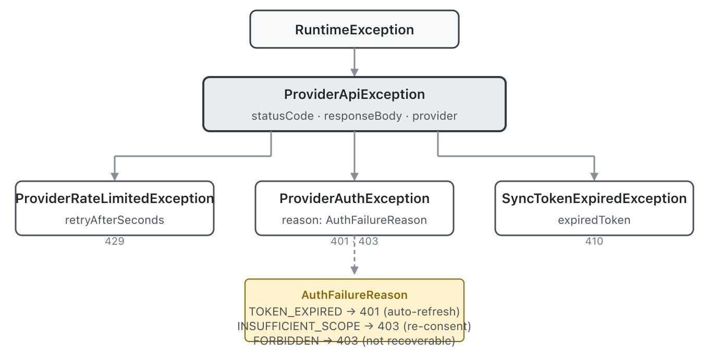

# The 403 That Isn't a Scope Problem

Four Google provider modules had been running with catch-all `RuntimeException` for every API error. No typed exceptions, no status code discrimination, no recovery metadata for callers. The bank-truelayer module had proper error handling — typed exceptions for 401, 404, 429, 500, each mapping to a specific recovery action — but the Google modules had been left behind.

The fix looked straightforward: create provider-agnostic exception types in connectors-api and wire them into all four modules. What made it interesting was the 403 problem.

## Not All 403s Are Created Equal

I'd initially designed `ProviderAuthException` to treat 401 and 403 as two flavours of the same problem — authentication failure. 401 means the token expired; 403 means you don't have the right scopes. Both need re-auth of some kind. Simple enough.

The design review caught this. Google APIs use 403 for at least four distinct situations: `insufficientPermissions` (you genuinely need broader scopes — re-consent can fix this), `domainPolicy` (the user's Google Workspace admin has disabled the feature — re-consent cannot help), `userRateLimitExceeded` (per-user quota, not a scope issue at all), and plain `forbidden` (account-level block). Mapping all of these to "ask the user to re-consent" would create a loop where the caller keeps prompting for scope escalation when the problem is organizational policy.

The solution was a reason discriminator on `ProviderAuthException` — an `AuthFailureReason` enum with `TOKEN_EXPIRED`, `INSUFFICIENT_SCOPE`, and `FORBIDDEN`. The shared `ProviderErrorMapping` utility inspects the Google error response's `reason` field, and only maps to `INSUFFICIENT_SCOPE` when the reason is specifically `"insufficientPermissions"`. Everything else defaults to `FORBIDDEN`.

This is a pattern that generalises. Any provider with a rich 403 space — and most OAuth2 providers have one — benefits from the discriminator rather than a flat 401-vs-403 split.

## Two HTTP Stacks, One Hierarchy

The four Google modules actually use two different HTTP stacks. Email, document, and contacts use the Google API Client Library (NetHttpTransport, `GoogleJsonResponseException` with structured error details). Location uses the Google Maps Java Client (OkHttp internally, `ApiException` subtypes like `OverQueryLimitException`).

For the API Client Library modules, a shared `ProviderErrorMapping.mapStatusCode()` centralises the status-code-to-exception mapping. Each module has a thin `handleGoogleError()` wrapper that extracts the status code and error reason from `GoogleJsonResponseException` and delegates. The mapping logic lives in one place.

The Maps module needs its own error handler because errors arrive as exception subtypes, not HTTP status codes. `OverQueryLimitException` maps to `ProviderRateLimitedException`; `RequestDeniedException` maps to `ProviderAuthException(FORBIDDEN)`. The Maps API doesn't distinguish scope problems from key problems — it's all `REQUEST_DENIED` — so `FORBIDDEN` is the right default.

## Fail-Soft Is a Behavioral Contract

The trickiest production decision was which methods should start throwing typed exceptions and which should keep returning empty results. The location module's search methods currently catch errors and return empty pages with a warning log. The review flagged that applying `handleMapsError` everywhere would silently change these from fail-soft to throwing — breaking callers that rely on empty-result-on-failure behaviour.

We kept the existing contract: search and geocoding methods stay fail-soft (they return empty, they don't throw). Only methods that already throw — `PlaceDetails.get()` and `Directions.route()` — got the typed exception upgrade. The distinction maps to intent: a search that returns nothing is a valid result; a point lookup that can't find its target is an error.

## The Gotchas That Google Doesn't Document

Two gotchas surfaced during WireMock testing of the Maps module. The Google Maps Java Client validates API keys at construction time — the key must start with `"AIza"` or the builder rejects it, even in test code pointing at localhost. And the client has built-in exponential backoff retry that will silently hang a test for 30+ seconds before the error surfaces. Disabling retries on the `GeoApiContext.Builder` fixes the test hang.

The document module had its own surprise: `executeMediaAndDownloadTo()` (the file download path) doesn't throw `GoogleJsonResponseException` on a 404. It throws a plain `HttpResponseException` — a different branch of the exception hierarchy — because the media download path doesn't parse JSON error bodies. The fix is a separate catch for `HttpResponseException` that extracts the status code and routes through `ProviderErrorMapping`.

## What This Opens Up

The exception hierarchy is provider-agnostic by design. `ProviderApiException`, `ProviderRateLimitedException`, and `ProviderAuthException` live in connectors-api and any provider can throw them. TrueLayer's existing exceptions — which predate this hierarchy — are candidates for migration to extend it, unifying the error handling across all providers. That's a separate issue, but the hierarchy is designed to absorb it without breaking callers.

`SyncTokenExpiredException` was already in connectors-api but extended `RuntimeException` directly. Re-parenting it under `ProviderApiException` means a caller who catches the base type now catches sync token expiry too — 410 is a provider API error just like 429 or 401, and excluding it from the hierarchy would have been a gap.
