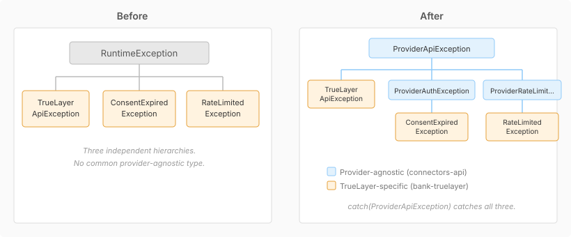

# Collapsing TrueLayer's Parallel Exception Hierarchy

When we added `ProviderApiException` and its subtypes in #179, TrueLayer still had its own parallel hierarchy — three exception classes extending `RuntimeException` directly, duplicating fields that the provider-agnostic types already carried. This was the cleanup.

The mapping was straightforward: `TrueLayerApiException` → `ProviderApiException`, `RateLimitedException` → `ProviderRateLimitedException`, `ConsentExpiredException` → `ProviderAuthException`. Each TrueLayer class keeps its existing constructor signature and delegates to super with `"truelayer"` as the provider. Fields that are now inherited — `statusCode()` on the API exception, `retryAfterSeconds()` on the rate limiter — get removed from the subclass entirely. The subclass becomes a constructor-only shell.

The interesting part was `ConsentExpiredException`. The original constructor took a `userId` parameter and baked it into the message string: `"Consent expired or not found for user 'X'"`. After extending `ProviderAuthException`, the message format comes from the hierarchy — `"truelayer API error (HTTP 401): TOKEN_EXPIRED"` — and the userId parameter had nowhere to go. The constructor still accepted it for backward compatibility, but silently dropped it.

We caught this during review. A userId that's accepted but discarded is worse than one that's absent — callers think they're providing diagnostic context, but it vanishes before anyone reads it. The fix was simple: keep the userId as a field with its own accessor. Callers still pass it the same way. The hierarchy gets its structured fields. And the userId survives for logging and debugging where it actually matters.

What this unlocks: any code that catches `ProviderApiException` now catches TrueLayer errors too, with the provider name, status code, and response body available through the standard accessors. No casting, no TrueLayer-specific imports. The catch blocks in `TrueLayerClient` still work — Java's multi-catch only objects when one alternative is a subtype of another, and since `ConsentExpiredException`, `RateLimitedException`, and `TrueLayerApiException` each extend a different branch of the provider hierarchy, they're fine.
