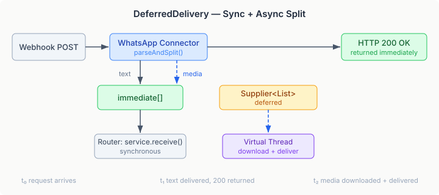
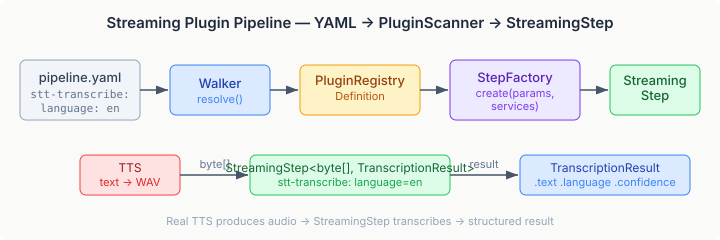

# When Your Webhook Needs Two Speeds

WhatsApp sends a webhook with two messages: a text greeting and an audio voice note. The text is ready to deliver. The audio needs a round-trip to Meta's Graph API to fetch the binary — three attempts with exponential backoff if the CDN is slow. The HTTP response has to go back now, or Meta starts retrying for the next 30 days.

This is a common shape in webhook-driven systems. Part of the payload is immediately actionable. Part requires async work that the caller cannot wait for. Most webhook handlers pick one: respond immediately and lose the heavy payload, or block the response thread and risk timeout cascades. Neither is right.

## DeferredDelivery

I added a fifth variant to the `WebhookResult` sealed interface:

```java
record DeferredDelivery(
    List<InboundMessage> immediate,
    Supplier<List<InboundMessage>> deferred) implements WebhookResult {}
```

The router delivers `immediate` messages synchronously, returns HTTP 200, and spawns a virtual thread for the `deferred` supplier. The connector stays passive — it just declares which messages are ready and which need work. Threading, error handling, and delivery are the router's problem.



The WhatsApp connector splits at parse time. Text messages go into `immediate`. Media messages (audio, image, document, video, sticker) produce a `MediaRef` that carries just enough context — sender, phone number ID, media ID, MIME type — for the deferred supplier to download and reconstruct a full `InboundMessage` with an `Attachment`.

Three design decisions worth calling out:

**Retry lives in the supplier, not the router.** The connector knows its platform's failure modes. WhatsApp media URLs are CDN-backed and transiently unavailable under load. Three attempts with 1s/2s/4s backoff matches the observed failure pattern. A generic router-level retry would apply the same policy to Gmail push notifications and Twilio callbacks, which have completely different failure characteristics.

**Download failure delivers metadata, not nothing.** When all three attempts fail, the deferred supplier still returns an `InboundMessage` — with `download-failed=true` and the media ID in metadata. The consuming application can decide whether to retry later, notify the user, or log and move on. Silent drops are the worst failure mode in messaging infrastructure.

**SSRF defense on the download URL.** The media URL comes from Meta's API response, not from the webhook payload. But a compromised or malicious API response could point at internal infrastructure. The download enforces HTTPS-only and blocks private IP ranges — same principle as the Discord attachment downloader, adapted for Meta's multi-CDN topology where a host allowlist would be too restrictive.

## VoicePlatform SPI

The deeper question behind the WhatsApp voice note is: what do you do with the audio once you have it?

I built a `VoicePlatform` SPI following the same pattern as the eleven other platform SPIs in connectors — `ChatPlatform`, `EmailPlatform`, `BankPlatform`, and so on. Two capability sub-interfaces: `SpeechToText` and `TextToSpeech`. A `NoOpVoicePlatform` that throws `UnsupportedCapabilityException` with recovery metadata. A `VoicePlatformService` registry. `@SimulationEligible` for the simulation framework.

The interesting part is how this plugs into the YAML pipeline runtime.

## Streaming Steps

The platform's YAML step runtime already had a concept of streaming steps — typed pipeline stages with an input type and an output type that can be fused when chained. I built `stt-transcribe` as a `@Plugin(streaming=true)` step:

```java
@Plugin(value = "stt-transcribe", streaming = true,
        description = "Transcribe audio bytes to text via VoicePlatform STT")
public record SttTranscribePlugin(
        @Optional String language,
        @Optional String model) {

    @Execute
    public TranscriptionResult apply(byte[] audio, VoicePlatform voicePlatform) {
        var options = TranscriptionOptions.defaults()
                .withLanguageHint(language)
                .withModelSize(model);
        return voicePlatform.speechToText().transcribe(audio, options);
    }
}
```

The `@Execute` method signature drives the wiring. The `PluginScanner` reads it reflectively: the first parameter (`byte[]`) is the streaming input type, remaining parameters (`VoicePlatform`) are resolved from the `ServiceRegistry` at runtime. The return type (`TranscriptionResult`) is the streaming output. No manual registration, no factory boilerplate.

In YAML, a pipeline step looks like this:

```yaml
steps:
  - step: transcribe
    stt-transcribe:
      language: en
```

The `Walker` resolves `stt-transcribe` against the `PluginRegistry`, the `StreamingStepFactory` creates a `StreamingStep<byte[], TranscriptionResult>` with the real `VoicePlatform` injected, and the pipeline runtime feeds audio bytes through it.



What makes this practically useful: when two consecutive streaming steps have compatible types (output of one matches input of the next), the `FusionPass` automatically fuses them into a single `FusedPipelineStep`. A future `tts-synthesise` step producing `byte[]` chained before `stt-transcribe` consuming `byte[]` would fuse into one pipeline stage with no intermediate buffering. The consuming application just writes YAML; the runtime handles the plumbing.

## Gmail Push

The third piece is Gmail push notifications via Pub/Sub. Google pushes a notification when new mail arrives; the connector fetches the actual messages via the History API.

The connector reuses `DeferredDelivery` — the notification itself carries no message content, just an email address and history ID. All the real work happens in the deferred supplier: acquire a per-user lock, compare the notification's history ID against the stored watermark, fetch new message IDs with pagination, get message summaries, advance the watermark.

Two things I got wrong initially and caught in review. The Pub/Sub push notification encodes its data in URL-safe Base64 (RFC 4648 §5), not standard Base64. And the history ID watermark needs to come from the history API response itself, not from a separate profile API call — otherwise messages arriving between the two calls get skipped silently. Both are the kind of bug that passes every unit test and fails in production under load.

## What This Opens Up

A WhatsApp voice note arrives. The webhook splits it: text greeting delivered immediately, audio downloaded asynchronously via `DeferredDelivery`. The audio bytes feed through `stt-transcribe` in a YAML pipeline. The transcription arrives as structured data — text, language, confidence. An agent step consumes it.

None of these components know about each other. The webhook connector produces `InboundMessage` with an `Attachment`. The pipeline step consumes `byte[]` and produces `TranscriptionResult`. The agent step consumes text. Each does one thing, declared in YAML, composed at runtime.

That is the point of infrastructure that stays infrastructure.
