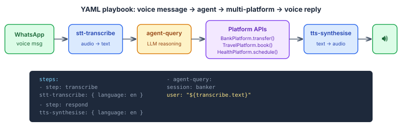

# YAML All the Way Down

A connector playbook that transcribes speech, checks a bank balance, and replies via WhatsApp should be testable without writing Java. The playbook is YAML. The test assertions are YAML. The service configuration is YAML. The simulation corpus is YAML. The only Java is the `@Plugin` record that defines the step — and that lives in the SPI module, not the test.

This is what we shipped today. Six playbook scenarios covering voice, banking, chat, and email — all tested end-to-end with zero Java test code.

## The shape of a playbook test

A banking voice assistant playbook looks like this:

```yaml
steps:
  - tts-synthesise: "What is my current account balance?"
    capture: inputAudio

  - stt-transcribe: "${inputAudio.audio-data}"
    capture: transcript

  - bank-balance: "acc-100"
    capture: balance

  - tts-synthesise: "Your balance is ${balance.amount} ${balance.currency}"
    capture: audio
```

Four steps, three domains (voice, bank, voice again), data flowing between them via named captures. The `${balance.amount}` expression resolves from the bank step's output — the playbook author controls exactly what's visible downstream.

The test YAML asserts on those captures:

```yaml
tests:
  - name: "bank balance retrieved and spoken as voice"
    steps:
      - run-playbook: voice-interaction-patterns/03-banking-assistant.playbook.yaml
        capture: result
      - assertThat: result.captures.balance.accountId
        equals: "acc-100"
      - assertThat: result.captures.balance.currency
        equals: "GBP"
      - assertThat: result.captures.audio.audio-format
        equals: "wav"
```

Every assertion traces to a named capture in the playbook. No magic keys, no flat-merged output bags, no guessing which step produced which value. `result.captures.balance.currency` means: the step that captured `balance` returned a map with `currency` in it. You can trace it from the test YAML to the playbook YAML without opening any Java file.

## Reference implementations are not test stubs

This is the point I want to emphasise. The `yaml-services.yaml` file maps SPI interfaces to implementations:

```yaml
io.casehub.connectors.voice.spi.VoicePlatform: io.casehub.connectors.voice.ref.ReferenceVoicePlatform
io.casehub.connectors.bank.spi.BankPlatform: io.casehub.connectors.bank.ref.RefBankPlatform
```

This isn't a test fixture. It's the default service configuration — used in tests, demos, local development, and onboarding environments. The same YAML playbook, the same reference implementations, the same seed data. A developer runs the playbooks locally to understand how the voice-banking flow works. A demo environment runs them to show the platform to prospects. A CI pipeline runs them to verify the steps still compose correctly.

Service profiles let you swap implementations without changing the playbooks:

```
yaml-services.yaml                    # default — lightweight ref impls
yaml-services-integration.yaml        # richer ref impls, full seed data
yaml-services-smoke.yaml              # minimal stubs for CI
```

Same playbooks, different backends. The playbook is the contract. The service configuration is the deployment concern.

## Round-trip verification

The voice tests use a pattern I'm particularly happy with. `ReferenceVoicePlatform` encodes text as bytes for TTS and decodes bytes back to text for STT. No silent WAVs, no canned responses — the content flows through.

```yaml
steps:
  - tts-synthesise: "I, Alice Smith, confirm this transaction of 500 pounds"
    capture: aliceAudio

  - stt-transcribe: "${aliceAudio.audio-data}"
    capture: aliceConfirmation
```

The test asserts that Alice's name survived the round-trip:

```yaml
- assertThat: result.captures.aliceConfirmation.text
  contains: "Alice Smith"
- assertThat: result.captures.aliceConfirmation.text
  contains: "confirm this transaction"
```

This isn't checking "did the step run." It's checking "did the content survive the pipeline." The joint-account confirmation playbook does this for both Alice and Bob — proving that two separate voice confirmations each preserve the speaker's identity and intent through TTS→STT.

With a real TTS engine, this round-trip becomes a genuine integration test. With the reference implementation, it validates the pipeline wiring. Both are useful. Both use the same YAML.

## @Plugin records — one record, any execution mode

Each domain step is a Java record:

```java
@Plugin(value = "bank-balance",
        description = "Look up account balance")
public record BankBalancePlugin(
        @Required String accountId,
        @Optional String userId) {

    @Execute
    public Result execute(BankPlatform bankPlatform) {
        var balance = bankPlatform.accountInformation(
                userId != null ? userId : "user-1")
                .balance(accountId);
        return Result.of(Map.of(
                "accountId", balance.accountId(),
                "amount", balance.available(),
                "currency", balance.currency()));
    }
}
```

Record fields are YAML inputs. The `@Execute` method's service parameters resolve from `ServiceRegistry` — the same registry populated by `yaml-services.yaml` in tests, by CDI in Quarkus, by auto-configuration in Spring. The plugin doesn't know and doesn't care.

The APT generates a manifest at compile time. `AptPluginSource` discovers it from the classpath. No manual registration, no scanner calls, no test wiring. Add the record, add the APT processor to your Maven config, and the step appears in playbooks.

Streaming plugins work the same way. `tts-synthesise` and `stt-transcribe` use `streaming = true` — the first `@Execute` parameter is the pipeline input. In streaming execution, it's fed by the pipeline. In non-streaming execution (playbook runner), it comes from the YAML step's scalar value. Same record, both modes.

## What this unlocks

The playbook module has no production Java. Its `src/main` is YAML playbooks and a service configuration file. Its `src/test` is YAML test files and a three-line JUnit Suite class. Adding a new scenario means writing three YAML files — playbook, test, and optionally a simulation corpus. No Java, no compilation, no build changes.

This matters because the audience for playbook scenarios is broader than the audience for Java unit tests. Product managers can read a playbook and understand what the banking assistant does. QA engineers can write test scenarios without touching Java. Demo teams can assemble new scenarios from existing steps without a development cycle.

The `@Plugin` records stay in the SPI modules — close to the interfaces they wrap. The playbooks module consumes them from the classpath. This separation means SPI authors can ship domain steps alongside their interfaces, and playbook authors can use them without knowing the SPI internals. The YAML surface is the contract.



Five platform issues surfaced during this work (#769–#773), all fixed same-day. ServiceRegistry forwarding, captures in results, streaming plugin non-streaming execution, record auto-unwrapping. Each was a gap between how `@Plugin` records work in CDI and how they need to work in the YAML test engine. Closing those gaps means the same plugin code runs identically in Quarkus, Spring, and the YAML test engine — no framework-specific adapters, no conditional wiring.

The remaining work is mechanical: APT processor on the SPI module POMs, the `Seedable` interface for corpus-driven ref seeding, and service profiles for environment-specific configurations. The architecture is in place. The playbooks prove it works.
