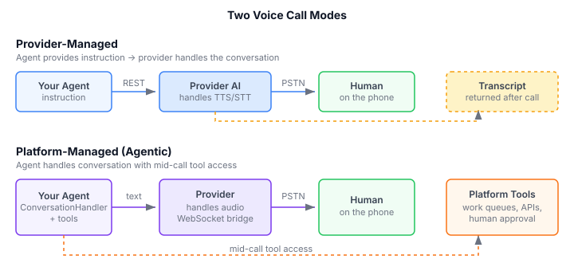
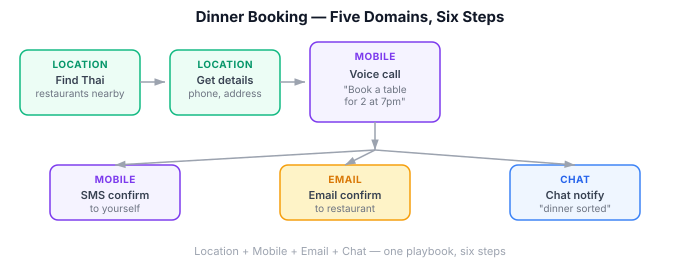

# When the Agent Picks Up the Phone

Every connector SPI we've built so far assumes the interaction is discrete. Send a message, get a response. Query an API, get data back. Even the voice platform — transcribe some audio, synthesise some speech — is request/response at its core. No state between calls, no conversation that outlives a single method invocation.

Telephony breaks that model. A phone call is a sustained, stateful interaction where the agent needs to listen, think, and respond in real time — potentially for minutes. It needs to negotiate ("we don't have 7pm, would 7:30 work?"), make decisions mid-conversation, and sometimes reach out to a human for approval before continuing. A fire-and-forget connector can't do this. A capability-based platform SPI can.

## The Instruction-Based Model

The conventional approach to programmable voice is bidirectional audio streaming — your code receives raw audio bytes, runs speech-to-text, decides what to say, generates speech, sends audio bytes back. You own the entire conversation pipeline. It's powerful and it's a lot of plumbing.

Providers like Dial have inverted this. You give the provider an instruction — a goal, not a script — and the provider's AI handles the entire conversation. It says hello, explains the booking, negotiates availability, confirms details, and hangs up. Your agent gets back a structured transcript with speaker turns and timing.

```java
Call call = platform.voiceCall().initiate(
    "+447700900000",
    "Book a table for 2 at 7pm tonight for Smith. "
    + "Be polite. If 7pm is unavailable, accept any time within an hour.");
// call.transcript() → the full conversation
// call.status() → COMPLETED, FAILED, BUSY, NO_ANSWER
```

The agent doesn't manage TTS or STT. It doesn't handle turn-taking. It sets a goal and reads the outcome. For straightforward interactions — bookings, enquiries, confirmations — this is the right abstraction. The interesting complexity is in what goal you set, not in how you handle audio codec buffering.

## When Goals Aren't Enough

But sometimes the agent needs to be in the conversation, not just set it up. The restaurant says they only have 8pm. The agent needs to check with the person who asked for the booking — "they only have 8pm, is that OK?" — before committing. That means pausing the live phone call, consulting a human through a work queue or chat message, waiting for a response, then resuming: "yes, 8pm works."

This is where `ConversationHandler` comes in. Instead of a string instruction, the caller provides a callback interface that receives the human's speech as text and returns what to say next:

```java
interface ConversationHandler {
    ConversationResponse onHumanSpeech(
        String text, List<TranscriptTurn> fullTranscript);
}
```

The provider handles audio — Dial through its self-hosted LLM WebSocket protocol, Twilio through Media Streams with platform STT/TTS. The handler operates entirely at the text level. It can take as long as it needs before responding — check a database, call an API, ask a human for approval. The call waits.

The response carries an optional action — `Hold` (speak some text, then immediately give the handler another turn without waiting for the human), `Transfer`, or `HangUp`:

```java
return new ConversationResponse(
    "Please hold while I check availability",
    new ConversationAction.Hold());
```



Both modes present as text at the SPI surface. Audio handling — WebSocket protocols, codec conversion, STT/TTS pipelines — is internal to each provider implementation. The consumer never touches audio.

## Five Domains, Six Steps

The dinner booking playbook is the proof that platform SPIs compose. Location finds the restaurant. Mobile calls it. Email confirms. SMS notifies. Chat reports back.

```yaml
steps:
  - location-search-nearby:
      latitude: 51.5074
      longitude: -0.1278
      category: restaurant
      keyword: thai

  - location-place-details:
      placeId: ${restaurants.items[0].placeId}

  - mobile-call:
      to: ${restaurant.phone}
      instruction: >
        Book a table for 2 at 7pm tonight for Smith.
        If 7pm is unavailable, accept within an hour.

  - mobile-send-sms:
      to: "+447700900000"
      body: "Booking confirmed at ${restaurant.name}."

  - messaging-send-email:
      to: bookings@thai-garden.example.com
      subject: "Booking confirmation — Smith, 2 guests"

  - chat-send:
      channel: personal
      message: "Dinner sorted. ${restaurant.name}, 7pm."
```



Each step is a different connector platform. Each platform has a reference implementation for testing — no API keys, no network, deterministic results in CI. The voice call step matches the instruction against canned conversation scripts in seed data and returns a pre-built transcript. Same SPI interface, same playbook syntax, real or simulated backends selected by deployment.

## Absorbing the Legacy

The old `TwilioSmsConnector` was a 47-line fire-and-forget connector. `WhatsAppConnector` was 72 lines. Both implemented the original `Connector` SPI — `send(to, body)` and done. They worked, but they lived in `connectors-api`, they had no capability introspection, and adding voice calls alongside them would have produced a bag of unrelated methods on an already-crowded interface.

The absorption moved SMS and WhatsApp delivery into `MobilePlatform` capabilities, but it couldn't just delete the old connectors and walk away. The notification bridge — the system that routes alerts to users via their preferred channel — discovers `Connector` beans by `channelType()` at startup. Delete `TwilioSmsConnector`, and every deployment that sends SMS notifications silently stops delivering them. No error. No log. Just missing messages.

The fix is a pair of thin bridge connectors that implement the old `Connector` interface but delegate to the new `MobilePlatform`:

```java
public class TwilioSmsConnectorBridge implements Connector {
    @Override public String id() { return "twilio-sms"; }
    @Override public String channelType() { return "sms"; }

    @Override public boolean send(ConnectorMessage message) {
        return platform.sms()
            .send(message.destination(), message.body()).ok();
    }
}
```

Same channel type, same connector ID, same notification behaviour — but the actual delivery now routes through the capability-based platform. The bridge is the seam between the old world and the new one. Downstream code doesn't know or care which side of the seam it's talking to.

## What the Code Review Caught

The WebSocket client for platform-managed calls via Dial had a lifecycle bug that wouldn't have shown up in a unit test. `handler.onCallConnected()` fired before the WebSocket connection was even established — so if DNS resolution failed, the handler would receive `onCallConnected()` followed immediately by `onCallEnded(FAILED)`. Two contradictory lifecycle events for a call that never existed.

The fix was straightforward — move the callback into the WebSocket's `onOpen` handler — but the bug was invisible until someone traced the callback sequence. The same review caught a WebSocket resource leak: on timeout, the connection was never closed, so repeated call timeouts would exhaust the HTTP connection pool. And a URL construction bug in the number lookup API: `jsonEscape` on a phone number passes `+` as-is, which HTTP interprets as a space.

None of these would have caused a test failure. The reference implementation doesn't use WebSockets. The Twilio client doesn't connect to Dial. The tests exercise the mapping layer, not the transport. This is the gap between "tests pass" and "the code is correct" — the gap that a structured review covers.

## Why Telephony Needs a Platform SPI

`MobilePlatform` follows the same composition pattern as `ChatPlatform` — a Builder assembles capabilities, unsupported ones get NoOp degradation defaults, `supports()` tells you what's real. Six capabilities: `Sms`, `VoiceCall`, `VoiceCallControl`, `Voicemail`, `Messaging`, `NumberInfo`. Each provider declares what it supports. Dial gets five. Twilio gets five. A future SMS-only provider gets one. The SPI doesn't care.

The alternative — a monolithic `TelephonyService` with methods for every operation across every channel — is what every telephony SDK looks like before it collapses under its own weight. Twilio's client libraries have hundreds of methods because they model the API surface, not the capability structure. When your agent needs to know "can I send WhatsApp through this provider?" the answer should be `platform.supports(Messaging.class)`, not a try-catch around an HTTP 400.

For agent systems, capability introspection isn't a convenience — it's how the agent decides what to do. An LLM agent selecting between providers needs structured metadata, not documentation. The `supports()` method and the `UnsupportedCapabilityException` with its recovery fields (`operation`, `capability`, `provider`, `supportedCapabilities`) give the agent everything it needs to self-correct: "Dial doesn't support voicemail, but Twilio does" is a structured fact the agent can act on, not a string it has to parse from an error message.

Thirteen platform SPIs now. The pattern holds.
