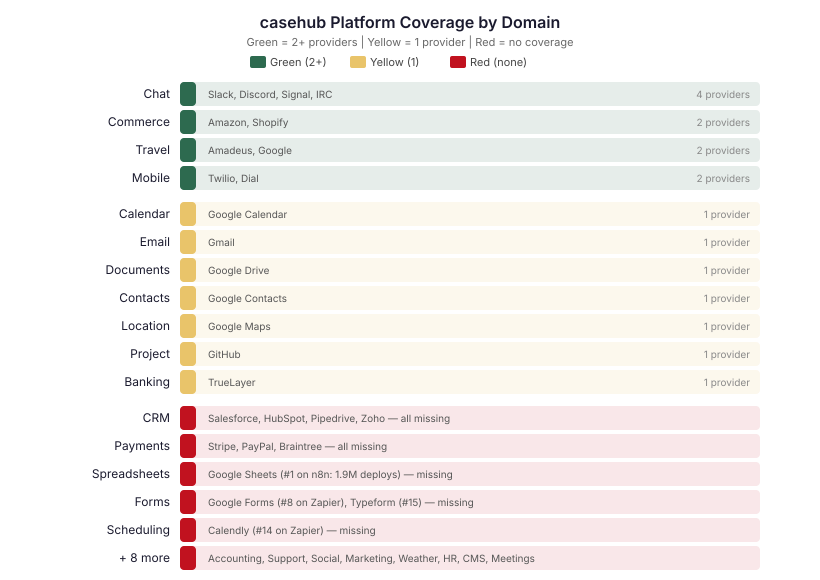

# The Connector That Understands

Zapier has 10,500 integrations. n8n has 400. casehub has 19. On the surface, that's an embarrassing deficit. I spent a session pulling apart what those numbers actually mean, and came out the other side with a different read: the number of connectors matters far less than what kind of abstraction they sit behind.

## The flat connector problem

Every integration platform I looked at — Zapier, n8n, Make — treats each connector as a flat, isolated unit. "Send a message to Slack" is one connector. "Send a message to Discord" is a completely separate one, with its own configuration, its own documentation, its own maintenance burden. They share nothing.

casehub doesn't work that way. We have a `ChatPlatform` SPI — a shared contract for what a chat system *is*: messages, channels, reactions, presence, members, commands. Slack implements it. Discord implements it. Signal implements it. IRC implements it. A playbook that uses `ChatPlatform` works against all four without modification.

The same pattern runs through the platform: `CalendarPlatform`, `BankPlatform`, `EmailPlatform`, `DocumentPlatform`, `ProjectPlatform`, `CommercePlatform` — 16 SPIs in total, each abstracting a domain. The per-provider cost drops with every new implementation because the contract, the MCP tools, and the step types already exist.

## What the data says

I cross-referenced n8n's integration catalog (ranked by deployment count) with Zapier's (ranked by active Zaps) to build a complete picture. n8n skews developer — databases, APIs, DevOps. Zapier skews business — CRM, marketing, forms, accounting, HR. Using either alone misses entire categories.

The heat map tells the story. casehub is green in chat, email, documents, commerce, travel — domains where the SPI investment has already paid off. But CRM, payments, spreadsheets, forms, scheduling, accounting, support, social, marketing — all red. Empty categories that any evaluation would flag immediately.

The fix isn't building 60 connectors. It's filling each red category with one provider and each yellow category with a second. That's roughly 14 new provider implementations to turn every red to yellow and every yellow to green. Several share an SDK — Microsoft Graph alone covers Outlook email, OneDrive, SharePoint, and Calendar from a single credential resolver.

## What Apache Camel taught us (by not being the answer)

I started this session thinking Apache Camel was the shortcut. Three hundred components, battle-tested, just wire them in. The pitch was seductive: add one dependency, get 30 connectors for free.

The reality fell apart on closer inspection. casehub's playbook executor already provides routing, EIP orchestration, and data transformation between steps — the three things Camel exists to do. Adding it would be a framework inside a framework, with competing lifecycle management, competing error handling, and Camel's Exchange model fighting the step model at every boundary.

For REST APIs (the bulk of the n8n gap), OpenAPI specs plus `HttpHelper` are cleaner and more current than Camel wrappers. For protocol infrastructure (Kafka, Redis, MongoDB, MQTT), Quarkus already has native extensions that integrate natively with CDI. For the handful of genuinely obscure protocols (FTP, LDAP, SMPP), thin wrappers over the underlying library are simpler than the camel-quarkus dependency chain.

## The federation insight

The SPI architecture enables something none of the flat-connector platforms can do: federated plugins.

Because every provider implements a well-defined interface, anyone can build one. A company needs a CRM integration for their internal system? They implement `CrmPlatform`, drop the JAR in a plugin directory, and it works — with every existing playbook, every MCP tool, every simulation wrapper. The SPI contract is the compatibility guarantee.

Two plugin tiers make this practical. Compiled JARs for providers that need real logic (webhook handling, OAuth2 flows, event streaming) — these require a server restart. YAML descriptors for the 80% that are just "call a REST API with credentials" — these load at runtime, no restart, no compilation. The descriptor format is simple enough for an LLM to generate: "connect casehub to my company's API" becomes a descriptor auto-generated from an OpenAPI spec.

Three distinct roles emerge. casehub defines what a CRM, a payment system, or a chat platform *is* (SPI author). Anyone maps a specific service's API to that contract (plugin author). End users write automation logic using domain operations without thinking about providers (playbook author). Zapier collapses all three — their node authors have to understand the framework, the API, and the user-facing experience.

## When the agent joins the meeting

One thing I hadn't considered until this session: the MeetingsPlatform SPI, and specifically how an LLM agent participates in a video call. Real-time video understanding isn't practical, but meaningful participation is.

The agent joins a Teams or Zoom call. It listens via STT — the `VoicePlatform` work we've already built. It speaks via TTS, routed through a synthetic avatar (HeyGen, D-ID) that gives it a face in the meeting. It can share its screen to present slides or dashboards. It can take periodic screenshots of the video feed and analyse them through a vision model — not real-time understanding, but "what's on screen right now?" And it can read the live transcript that Teams and Zoom provide natively.

Most of the foundation already exists. `VoicePlatform` handles STT and TTS. `MobilePlatform` handles phone calls. The meeting-specific work is join/leave, audio stream routing, and share controls. A `TranscriptionPlatform` sitting beneath all of it — meetings, voice calls, voicemails — provides speaker diarisation, so the LLM knows *who* is saying what.

The competitive frame changes at this point. Zapier connects to 10,500 apps. casehub understands 30 domains, lets anyone extend them, and can sit in a meeting and take notes. Different kind of integration entirely.
