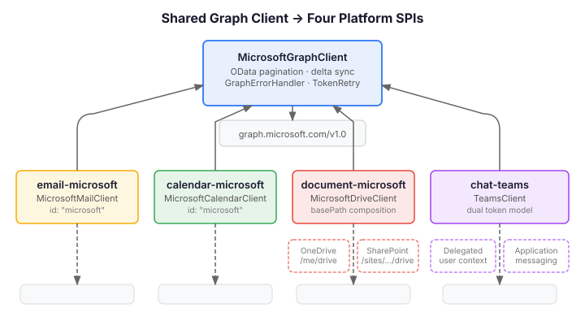

# One Client, Four Platforms

Microsoft Graph is one API surface that covers email, calendar, files, and chat. Most integrations treat it as four separate things — four SDKs, four auth configurations, four error handling strategies. We built it as one.

`MicrosoftGraphClient` is 200 lines of shared HTTP plumbing: OData pagination that handles `@odata.nextLink` for regular pages and `@odata.deltaLink` for incremental sync, `GraphErrorHandler` that maps Graph's 403/429 responses to the typed exception hierarchy the rest of the platform already understands, and `TokenRetry` that catches `TOKEN_EXPIRED` and re-resolves once before failing. Every Microsoft provider module depends on this single client.

The four provider modules — `email-microsoft`, `calendar-microsoft`, `document-microsoft`, `chat-teams` — each follow the same three-class pattern: a package-private client that wraps `MicrosoftGraphClient` with domain-specific API paths, a static mapper that converts Graph JSON into SPI model records, and a public platform class that wires the two together with token resolution. Adding a fifth Microsoft provider (contacts, say) means writing those three classes against an already-proven client.

The interesting design pressure came from document and chat.

## Two beans from one module

OneDrive and SharePoint are the same API — the only difference is the base path. OneDrive uses `/me/drive`; SharePoint uses `/sites/{siteId}/drive`. Rather than two modules with identical code, `MicrosoftDriveClient` takes a `basePath` parameter. `DocumentMicrosoftBeans` produces two CDI beans from one module: `microsoft-onedrive` and `microsoft-sharepoint`. If the SharePoint site ID isn't configured, the SharePoint bean starts in degraded mode — `supports()` returns false for all capabilities, every operation throws `IllegalStateException`. No crash, no missing-bean errors, just a provider that honestly reports it can't do anything.

Download needed SSRF defense. Graph's `/content` endpoint doesn't return the file — it returns a 302 redirect to a CDN blob URL. Following that redirect blindly means a compromised Graph response could redirect you to an attacker-controlled server. We validate the `Location` header against a set of known Microsoft CDN suffixes (`.sharepoint.com`, `.1drv.com`, `.blob.core.windows.net`) before following. The pattern follows what we already do for Discord attachment downloads — different CDN, same principle.

## The dual token problem

Every other chat platform in the system uses one token. Teams needs two.

Discovery, presence, and member operations require delegated tokens — a user's own permission, scoped to what they can see. But sending messages and reading history require application tokens — tenant-level permission that works without a user context. This is Graph's permission model for Teams, and it's not something you can work around.

`TeamsChatPlatform` resolves tokens through two paths: `resolveDelegatedToken()` hits `ServiceConnectionProvider` with provider `"microsoft"`, while `resolveApplicationToken()` uses a synthetic `"__application__"` actor ID with provider `"microsoft-app"`. Each capability method routes through the correct path. The Builder pattern handles the rest — eight capabilities are native, Reactions and Commands auto-degrade to no-ops because Graph doesn't support them (reactions need the Bot Framework, which is a separate infrastructure entirely).

Channel IDs are compound: `teamId:channelId`. Teams requires both for every operation, and channel IDs themselves contain colons (`19:abc@thread.tacv2`). Splitting on the first colon works because team IDs are GUIDs — and GUIDs never contain colons. A small thing, but the kind of thing that becomes a production bug if you parse carelessly.

## What makes this different

The Microsoft Graph SDK for Java is 47,000 lines of generated code. Our four provider modules total about 1,800 lines of hand-written code against the raw REST surface. The SPI abstraction means a consumer switching from Google Calendar to Outlook Calendar changes a Maven dependency — not their code. That's the payoff of building providers as thin adapters over a shared client, rather than wrapping vendor SDKs.
