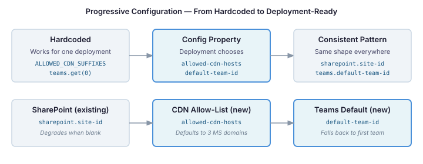

# The Bug the Tool Wrote

A code review caught a bug that no test would ever find — because the test had the same bug.

I was reviewing the `TeamsMapper.toMessageBody()` changes that add markdown-to-HTML conversion and RichCard-to-Adaptive-Card mapping. The `escapeHtml` method looked fine at first glance:

```java
private static String escapeHtml(String text) {
    return text.replace("&", "&")
               .replace("<", "<")
               .replace(">", ">");
}
```

Three replacements, each replacing a character with... itself. A perfect no-op. The method compiles, runs, and returns the input unchanged.

The test passed too:

```java
assertThat(html).contains("<div>").contains("&");
```

That assertion verifies the unescaped characters are present — which they are, because nothing was escaped. The test looks like it's checking for HTML entities, but it's checking for the raw characters.

Both the production code and the test were written through IntelliJ's MCP insert tool. The tool interpreted the HTML entity references during insertion, rendering `&amp;` as `&`, `&lt;` as `<`, and `&gt;` as `>`. The code that arrived in the file was semantically different from the code that was authored.

This is a tooling-shaped bug. It's not a typo or a logic error — it's a correct program that was silently transformed into an incorrect one by the tool that wrote it to disk. And because the test went through the same tool, both sides of the verification were equally mangled. Green bar, zero value.

The fix was straightforward once spotted. The deeper question is what catches bugs like this. Not the compiler — it's valid Java. Not the test suite — the test was wrong in the same way. What caught it was reading the raw bytes during code review and noticing that a security-relevant method was doing nothing.

## Making the Providers Deployment-Ready

The escapeHtml fix was part of a broader session hardening the Microsoft Graph providers that shipped last week. Five issues, all small, all aimed at the same thing: taking providers that work in development and making them configurable for production deployments.



The pattern is consistent across all three. SharePoint already had it — `casehub.connectors.sharepoint.site-id` controls which site's drive to use, defaulting to degraded mode when blank. We applied the same shape to two more decisions that were hardcoded:

**CDN allow-list.** `MicrosoftDriveClient` validates redirect URLs during file downloads as SSRF defence — only allowing redirects to `.sharepoint.com`, `.1drv.com`, and `.blob.core.windows.net`. That's correct for standard Microsoft 365, but sovereign cloud deployments use different domains. The allow-list is now a constructor parameter, injected from `casehub.connectors.microsoft.allowed-cdn-hosts` with the original three as defaults.

**Default team for channel creation.** `TeamsChatPlatform.ChannelManagement.create()` called `listJoinedTeams()` and used `teams.get(0)` — always creating channels in whatever team happened to be first. Fine for a single-team org, wrong for everything else. Now accepts `casehub.connectors.teams.default-team-id`, falling back to the old behaviour when unset.

Neither change is architecturally interesting on its own. What's interesting is the pattern becoming consistent: every deployment-specific decision follows the same shape. Config property with a sensible default. Behaviour unchanged when unconfigured. Explicit when configured.

## Adaptive Cards and the Rich Content Gap

The other half of this session was `TeamsMapper.toMessageBody()`, which was ignoring everything except `ChatContent.text()`. Markdown, RichCards, attachments — all dropped.

Teams Graph API accepts HTML in message bodies and Adaptive Cards as attachments. The mapping from our `ChatContent` model:

- **Markdown** → basic HTML conversion (bold, italic, code, links, newlines). The converter is intentionally simple — Teams' own HTML renderer handles the hard cases. We escape HTML entities first, then apply regex replacements, so user content can't inject markup.

- **RichCard** → Adaptive Card attachment. A `RichCard` with title, description, fields, and a URL becomes an Adaptive Card with `TextBlock` elements, a `FactSet` for fields, and an `Action.OpenUrl`. The card JSON goes into the message's `attachments` array as a string, with an `<attachment>` reference in the HTML body.

Discord had this pattern already — `toEmbeds(content.cards())` maps RichCards to Discord embeds. Slack has `serializeToBlocks()`. Each platform's rich content format is different, but the source model is the same `RichCard`. That's the SPI doing its job — one model, three renderings.

File attachments are still deferred. Teams requires uploading to SharePoint before referencing in a message — a multi-step flow that deserves its own issue, not a footnote in a mapper fix.

The resumable upload path in `MicrosoftDriveClient` also got test coverage this session. The code was already correct — chunked PUT with Content-Range headers — but had no tests. Four tests now cover single-chunk uploads, multi-chunk with Content-Range verification, error propagation, and filename encoding.

Something worth noting about that filename encoding test: the assertion originally checked for `%20` in the URL, but the actual output was `%2520` — double-encoded because `URLEncoder.encode()` produces `%20` and then `URI.create()` re-encodes the `%`. The test now just verifies the raw space isn't present. The double-encoding is a pre-existing quirk, not a regression, and Graph API handles it correctly.
