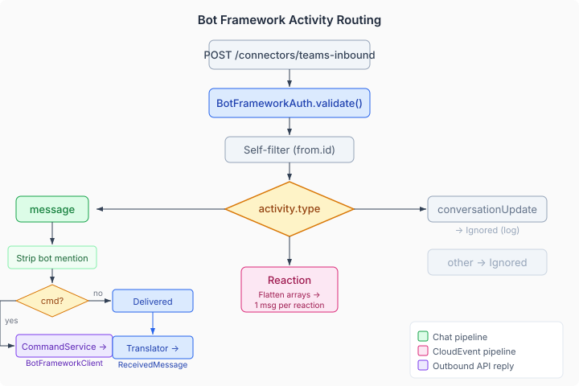

# From Shared Secret to JWT

The Teams inbound connector was the simplest in the system. HMAC-SHA256 with a Base64-encoded shared secret, a handful of JSON fields, and about 80 lines of code. It received messages from Teams Outgoing Webhooks — a configuration you set up in a Teams channel with no Azure resources involved.

The problem was everything it couldn't do.

Outgoing Webhooks can send text to a webhook endpoint. That's it. No reactions, no slash commands, no knowledge of who joined or left a channel, no way for the bot to reply beyond the HTTP response body. Every other chat platform in the system — Slack, Discord, Signal — had an inbound pipeline that fed into the `ReceivedMessage` chat layer. Teams was stuck at the `InboundMessage` transport layer with no translator to bridge the gap.

The fix was Bot Framework — Microsoft's webhook infrastructure for bots. Same webhook endpoint, fundamentally different auth model, and a much richer Activity payload that carries messages, reactions, conversation updates, and command invocations through a single POST.

## The auth model that isn't HMAC

The first design instinct was to keep authentication JDK-only, the way every other connector does it. `SigHelper` handles HMAC for Slack, Discord uses Ed25519 via `java.security.Signature` — both are single-primitive verifications where the JDK gives you everything you need in a few lines.

Bot Framework JWT validation is not a single-primitive operation. It's a multi-step protocol: fetch OpenID Connect metadata from Azure AD, discover the JWKS endpoint, download the signing keys, cache them with a 24-hour TTL, refresh on `kid` mismatch (rate-limited to prevent abuse), validate the RS256 signature, then check four claims — issuer, audience, expiry, and a `serviceurl` claim that binds the token to the specific Bot Framework service URL. Writing that from scratch is 200–300 lines of security-critical code.

I chose [nimbus-jose-jwt](https://connect2id.com/products/nimbus-jose-jwt) instead. It's the library underneath Spring Security's `spring-security-oauth2-resource-server` — framework-agnostic, no Quarkus or Spring coupling, works identically on both runtimes. The `connectors-spring` module gets parity for free. One dependency that handles JWKS rotation, key caching, and RS256 verification correctly, so I don't have to.

`BotFrameworkAuth` wraps nimbus in about 90 lines: validate, find key, refresh keys, fetch JWKS URL from OpenID metadata. Dev-mode skips validation entirely with a `SECURITY WARNING` on every request — useful when testing with the Bot Framework Emulator locally, dangerous anywhere near production.

## One webhook, four activity types

Bot Framework sends everything through one endpoint. The Activity JSON has a `type` field that determines what it is:

**Messages** are the straightforward case — parse `activity.text`, strip the bot mention (Teams prepends `<at>BotName</at>` to every message addressed to the bot), check for command prefixes, deliver as `InboundMessage`. The mention stripping is entity-based: find the mention entity in `activity.entities[]` where `mentioned.id` matches the bot's app ID, remove that entity's text value from the message, trim. This preserves mentions of other users — a regex like `<at>.*?</at>` would strip them all.

**Reactions** arrive as `messageReaction` activities with `reactionsAdded` and `reactionsRemoved` arrays. Each array entry is a single reaction type — `like`, `heart`, `laugh`, `surprised`, `sad`, `angry`. We flatten these into individual `InboundMessage` records so downstream consumers can process each reaction independently. One activity with three reactions produces three messages. The `TeamsInboundTranslator` rejects these with an `IllegalArgumentException` — reactions aren't chat messages, so they flow only through the CloudEvent pipeline where consumers can filter on `teams-activity-type`.

**Commands** in Teams work differently from Discord and Slack. Discord has a separate Interactions API; Slack has a separate Slash Commands endpoint. Bot Framework delivers commands as regular message activities — the bot parses the text, matches the first word against registered command names, and dispatches to `CommandService`. And there's a catch: Bot Framework discards the HTTP response body for message activities. Every other webhook connector can put the command response in the HTTP body. Teams can't. Both immediate and deferred command replies go through `BotFrameworkClient.replyToActivity()` — an outbound REST call to the Bot Framework service URL.

**Conversation updates** (member join/leave) are logged and ignored. The connector returns `Ignored` for anything it doesn't recognise — `invoke` activities for Adaptive Card actions are explicitly out of scope until there's a reason to handle them.

## SSRF defense on serviceUrl

Every Bot Framework activity carries a `serviceUrl` — the endpoint where the bot sends replies. For Teams in the public cloud, that's `https://smba.trafficmanager.net/teams/`. The bot must use this URL for all outbound calls. If an attacker could forge an activity (or the JWT validation had a flaw), they could redirect the bot's outbound traffic to an arbitrary server.

`BotFrameworkClient` validates the `serviceUrl` hostname against a configurable allowlist before every outbound call. The default allows `*.botframework.com` and `smba.trafficmanager.net`. Government and sovereign cloud deployments can add their own hosts. The JWT `serviceurl` claim provides a second layer — it binds the token to a specific service URL, so even a valid token from one channel can't redirect traffic to another.

This follows the same pattern we use for Discord CDN attachment downloads and OneDrive/SharePoint download redirects — different CDN, same principle.

## The self-filter that wasn't

Claude caught a bug during code review that would have been invisible in testing. The self-filter — defense-in-depth against infinite loops where the bot processes its own messages — checked `appId.equals(fromId)`. The problem: when `casehub.connectors.teams-bot.app-id` is not configured (empty string, the default), `"".equals("")` is true. Every activity with a missing or empty `from.id` would be silently dropped.

Bot Framework always includes `from.id` in practice, so this would never surface in integration tests against a real Bot Framework endpoint. It would surface in exactly one scenario: a misconfigured deployment with no app ID set, where the connector silently drops everything with no error, no log, no indication of what's wrong. The fix is one word: `!appId.isBlank() && appId.equals(fromId)`.

## What this opens up

Teams now has the same inbound pipeline as every other chat platform. Messages arrive, get translated to `ReceivedMessage`, feed into the chat layer. Commands dispatch through `CommandService`. Reactions flow through CloudEvents.

The platform description for Teams used to say: "8 native capabilities. Reactions and Commands auto-degrade to no-ops because Graph doesn't support them." Commands now work. Outbound reactions — adding a thumbs-up to someone's message — are a different story. Bot Framework's REST API has no endpoint for adding reactions. That's a Teams-specific API still in preview with no stable REST surface. It'll come, but not through Bot Framework.
