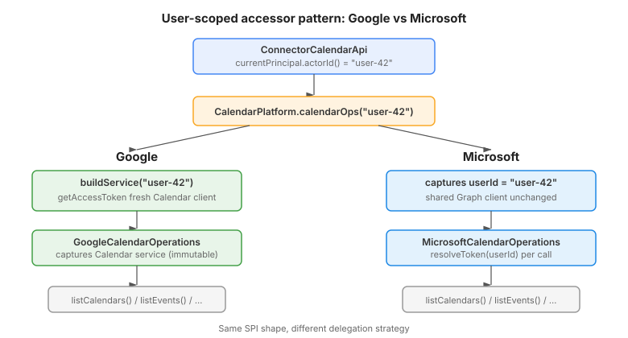

# The Three That Forgot Who Asked

The connectors repo has thirteen platform SPIs. Ten of them know which user they're acting for. Three didn't — CalendarPlatform, DocumentPlatform, and EmailPlatform were built before per-user OAuth mattered, and their method signatures carried no user context at all.

This matters once you leave single-user deployment. `ServiceConnectionProvider.getAccessToken(String actorId, String provider, String tenancyId)` already supports per-user tokens — the infrastructure was ready. But CalendarPlatform's `listCalendars()` has no parameter to thread an actorId through. Microsoft's implementation was passing `null`. Google Calendar had a `buildService(String actorId)` helper internally, but no way for the SPI to reach it. The per-user plumbing existed everywhere except at the interface boundary.

The fix was straightforward because seven other SPIs had already solved this problem. ContactsPlatform uses `contactRead(String userId)` to return a capability sub-interface — the userId flows from there to the token provider, and the flat operations underneath don't need to carry it. BankPlatform, ProjectPlatform, CommercePlatform, all the same shape. The pattern was proven; the three older SPIs just hadn't been updated to match.

**CalendarPlatform and EmailPlatform** got the full restructure — flat methods pulled into an inner `CalendarOperations` / `EmailOperations` interface behind a user-scoped accessor:

```java
CalendarOperations calendarOps(String userId);

interface CalendarOperations {
    List<CalendarInfo> listCalendars();
    CalendarEvent getEvent(String calendarId, String eventId);
    // ...
}
```

**DocumentPlatform** was simpler. It already had capability sub-interfaces — `FileOperations`, `FolderOperations`, `SearchOperations`, `SharingOperations` — accessed through flat methods. Adding `String userId` to each accessor was a one-line change per method. The inner interfaces stayed unchanged.

The interesting finding is how the same accessor pattern handles two very different OAuth architectures underneath. Google builds a per-user API client — `calendarOps(userId)` calls `buildService(userId)`, which resolves a token via `ServiceConnectionProvider`, wraps it in a `GoogleCredentials` object, and constructs a fresh `Calendar` client scoped to that user. The inner class captures the client and uses it for every subsequent call. Microsoft doesn't build per-user clients — the Graph client is shared. Instead, `calendarOps(userId)` captures the userId string, and each operation calls `resolveToken(userId)` at execution time via `TokenRetry`. Different delegation strategies, identical SPI shape.



The MCP/GraphQL boundary is where userId enters the system. `ConnectorCalendarApi`, `ConnectorDocumentApi`, and `ConnectorEmailApi` already had CDI injection — adding `CurrentPrincipal` and calling `currentPrincipal.actorId()` at each entry point was mechanical. The SPI stays explicit and testable; `CurrentPrincipal` stays at the request edge where it belongs.

One thing we deferred: the playbook plugin layer. `EmailMessagesPlugin` calls `emailOps(null)` because playbook steps don't carry user context yet. That's the correct pass-through — it preserves existing behaviour — but it means the plugin framework needs its own userId resolution story. That's a separate concern from the SPI retrofit.

The pattern continues to prove itself. Thirteen SPIs, two OAuth architectures, one accessor shape. When the accessor absorbs both "build a fresh client" and "capture a string for later", the abstraction boundary is in the right place.
