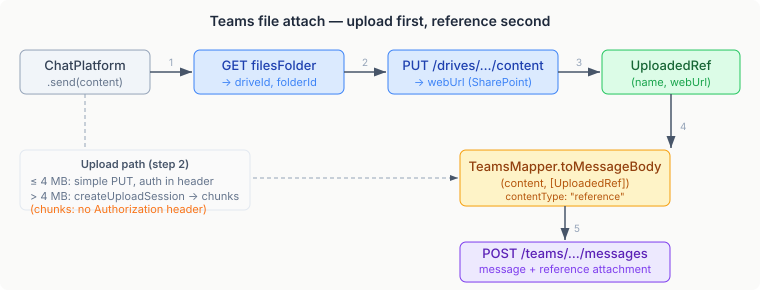

# Upload First, Then Attach

Most messaging APIs let you attach a file to a message by including it in the request — multipart body, inline bytes, however they want it. Teams doesn't. To attach a file to a Teams channel message, you first upload it to SharePoint, then reference the uploaded URL in the message payload. The file has to exist somewhere Microsoft controls before the message body can point at it.

This shapes everything downstream.

## The three-step Graph API flow

The simplest case — file under 4MB — is still three round-trips:

1. `GET /teams/{teamId}/channels/{channelId}/filesFolder` → returns a DriveItem with the channel's SharePoint folder: `driveId` and the folder's item ID.
2. `PUT /drives/{driveId}/items/{folderId}:/{filename}:/content` → uploads the bytes, returns a DriveItem with `webUrl`.
3. Build the message body with an `attachments` array entry where `contentType` is `"reference"` and `contentUrl` is the SharePoint URL. Include `<attachment id="file-N">` placeholders in the HTML body.



For files over 4MB, step 2 becomes an upload session: `POST .../createUploadSession` to get an `uploadUrl`, then PUT chunks of 16×320KB to that URL with `Content-Range` headers. The chunked PUT responses are either 202 Accepted (more chunks needed) or 201 Created (final chunk, includes the DriveItem JSON).

The uploadUrl is pre-authenticated. That's the non-obvious constraint: chunk PUTs must go out **without** an Authorization header. If you route them through a client wrapper that always adds the token, they fail. The upload session URL is a bearer credential in its own right — Microsoft's design, not a quirk.

## Keeping the mapper pure

`TeamsMapper.toMessageBody()` has always been a pure static method. No I/O, no tokens, no side effects — just `ChatContent → JsonObject`. That's the right boundary. The mapper knows how to format a Teams message; it doesn't know how to authenticate against Graph.

The right place for uploads is `TeamsChatPlatform.sendMessage()`, which already holds the token resolution logic. The sequence is: get the folder, upload each attachment, collect `UploadedRef(name, webUrl)` values, then pass the refs into an extended `toMessageBody(content, uploadedRefs)`. The 1-arg overload still exists as a delegate for call sites that have no attachments.

The mapper doesn't see bytes or tokens. It sees names and URLs — which is exactly what it needs to build the JSON.

## The filename encoding bug

Filenames go into the Graph URL path URL-encoded. `"my file.pdf"` becomes `"my%20file.pdf"` in the PUT path. That's correct.

But the `createUploadSession` request also includes the filename in a JSON body — the `item.name` field that tells Microsoft what to call the stored file. I initially passed the URL-encoded name there too. The result: a file called `"my%20file.pdf"` on SharePoint, and that URL-encoded string appearing as the display name in the Teams message attachment.

Claude caught this in the review pass. The fix is to keep both forms — `filename` (original, human-readable) for the JSON body, `encodedName` (percent-encoded) for the URL path. The upload methods take both. It's a small thing but the kind that tests don't catch, because a stubbed HTTP client doesn't care whether the JSON name looks right.

A second issue in the same pass: `uploadAttachments` was using `item.getString("name")` from the Graph response as the display name, on the assumption that Graph echoes back what you sent. It does — but if you sent the encoded version, that's what you get back. Using the locally-computed `name` from `safeAttachmentName()` is more reliable.

## What it means in practice

A caller can now pass `ChatContent` with attachments and the `TeamsChatPlatform` handles the rest:

```java
var content = new ChatContent("See attached report", null,
    List.of(new Attachment("Q3-report.pdf", "application/pdf", pdfBytes)),
    List.of());

platform.messaging().send(channel, content);
```

The attachment lands in the channel with a SharePoint reference — clickable, previewable in Teams. The Teams app registration needs `Files.ReadWrite.All` application permission for this to work; without it you get a 403 on the upload step, not on the message send.

Upload failure fails the whole send. No partial delivery — if you send three attachments and the second upload fails, the message is not sent at all. Callers can retry on `ProviderRateLimitedException` if the graph API is throttling.
