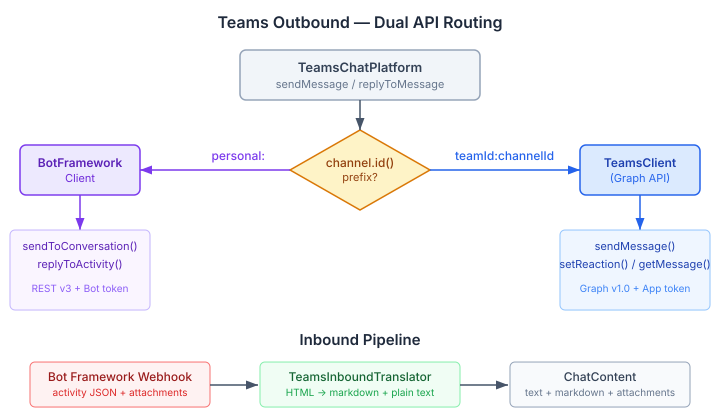

# Two APIs, One Platform

Microsoft Teams is actually two APIs wearing a trenchcoat. The Graph API handles team channels — messages, reactions, file uploads, member management. The Bot Framework handles personal 1:1 chats — direct messages between a user and a bot. Neither can do the other's job. And the ChatPlatform SPI has to make both look like one thing.

The routing decision happens at a single point: the channel reference prefix. Team channels arrive as `team-1:19:general@thread.tacv2` — a compound ID with the team and channel separated by a colon. Personal chats arrive as `personal:conv-123`. One prefix check in `sendMessage` decides the entire outbound path.

```java
private SendResult sendMessage(ChatChannelRef channel, ChatContent content) {
    if (isPersonalChannel(channel.id())) {
        return sendPersonalMessage(extractConversationId(channel.id()), content);
    }
    var tc = TeamsMapper.parseTeamAndChannel(channel.id());
    // ... Graph API path with token retry, file upload, rich content
}
```

The Graph path goes through `TeamsClient` → `MicrosoftGraphClient` with application-scoped tokens, file pre-upload to SharePoint, and HTML message bodies. The personal path goes through `BotFrameworkClient` with bot tokens and plain text. They share nothing except the `SendResult` they return.



## Reactions through a different door

Slack and Discord both use emoji names for reactions — `thumbsup`, `heart`, standard Unicode emoji identifiers. Teams Graph API uses a fixed set of reaction types: `like`, `heart`, `laugh`, `surprised`, `sad`, `angry`. No custom emoji. No Unicode.

The Graph API's approach is also structurally different from the other platforms. Slack has explicit `reactions.add` and `reactions.get` endpoints. Discord has `PUT /reactions/{emoji}` and `GET /reactions`. Teams has `setReaction` and `unsetReaction` as POST operations on the message, and the only way to list reactions is to fetch the entire message and read its `reactions` array.

```java
public List<String> list(ChatMessageRef message) {
    // ... fetch the full message just to read reactions
    var msg = client.getMessage(tc[0], tc[1], message.messageId(), token);
    return msg.getJsonArray("reactions").stream()
              .map(r -> r.asJsonObject().getString("reactionType"))
              .distinct()
              .toList();
}
```

This means a `reactions.list()` call on Teams is a full message GET, while on Slack it's a lightweight metadata call. The SPI abstracts this — callers don't know — but the performance characteristics are different. Worth knowing if you're polling reactions.

## The HTML that arrives instead of text

Bot Framework activities deliver message content as HTML. Bold text arrives as `<b>bold</b>`, mentions as `<at>BotName</at>`, line breaks as `<br>`. The `ChatContent` model has two text fields — `text` (plain) and `markdown` (formatted). If we pass the raw HTML through as plain text, consumers see angle brackets. If we strip tags without converting, we lose the formatting intent.

The solution: detect HTML, convert both ways. `htmlToMarkdown` turns `<b>` into `**`, `<i>` into `*`, `<a href>` into `[text](url)`, and strips `<at>` mention tags. `htmlToPlainText` strips everything and decodes entities. When the content has no HTML tags, it passes through unchanged — the `ChatContent` gets `null` for markdown, which is the established signal for "no formatting present."

One subtlety: HTML entity decode order matters. `&amp;lt;` is a legitimate sequence meaning a literal `&lt;` in the text. If you decode `&amp;` to `&` first, the result is `&lt;`, which then matches the `&lt;` → `<` rule and produces a bare `<`. Decoding `&amp;` last prevents this double-decode chain.

## What this adds up to

Teams started this session at 8 native capabilities — Messaging, Threading, Discovery, Presence, Members, ChannelManagement, MemberManagement, MessageHistory. It now has 9 with Reactions, and the existing capabilities work in both directions: inbound messages arrive with formatting preserved and attachments downloaded, outbound messages can target both team channels and personal conversations.

The personal chat path is intentionally minimal — plain text only, no rich content, no file attachments. That's a known limitation documented in the issues. The Bot Framework v3 API supports richer payloads, but wiring them through `TeamsMapper.toMessageBody` is a separate piece of work that shouldn't block the basic send/reply path.

The interesting architectural observation: every other chat platform in the system (Slack, Discord, Signal, IRC) uses one API for everything. Teams is the only one where the outbound routing decision splits into two fundamentally different HTTP clients with different auth models, different payload formats, and different endpoint structures. The SPI hides this — a caller sends to `personal:conv-123` the same way they send to `team-1:channel-1` — but inside the platform, the code paths share almost nothing.
