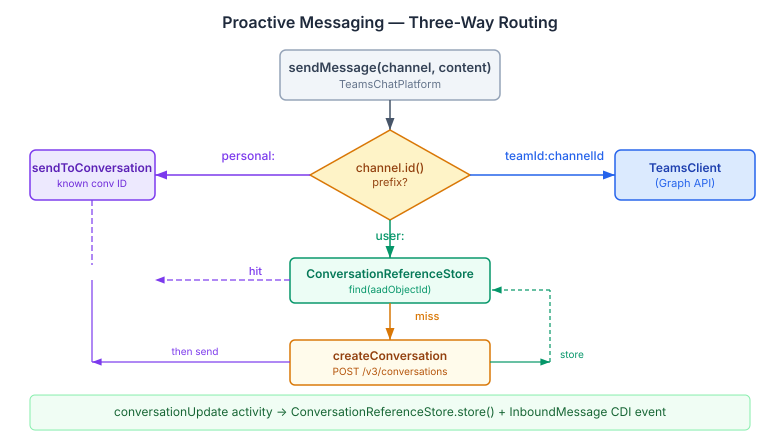

# The Bot Speaks First

Every chat connector in the system works the same way: a user sends a message, the bot handles it. The user always initiates. The bot always responds. This is fine until you need an alert, a welcome message when someone installs the bot, or a notification that something happened in another system. Then you need the bot to speak first — and the reactive model breaks down.

In Slack and Discord, this is trivial. You have the user's ID, you open a DM channel, you post to it. The platform handles conversation creation invisibly. Bot Framework doesn't. A Teams bot cannot message a user it has never interacted with unless it explicitly creates a conversation first through `POST /v3/conversations`. No conversation object, no message delivery.

## Two paths to the same endpoint

The design has two paths because the cost structure is different depending on whether you've seen the user before.

If a `conversationUpdate` activity already arrived — the user installed the bot, or joined a channel where the bot lives — we have their conversation reference cached. `serviceUrl`, `conversationId`, `tenantId`, everything needed to send directly. One API call: `sendToConversation`. No round trip to create anything.

If we've never seen them, we cold-start: `POST /v3/conversations` with the user's AAD Object ID and tenant, receive a new conversation ID, cache it, then send. Two API calls the first time, one call every time after.

The caller doesn't know which path runs. They send to `user:aad-object-id` and get back a `SendResult` with a `personal:` conversation reference they can reuse. The three-way prefix routing in `sendMessage` — `personal:` for known conversations, `user:` for proactive targeting, `teamId:channelId` for team channels — is invisible outside the platform.



## The store that doesn't need to persist

`ConversationReferenceStore` is a CDI SPI — an interface with an `@DefaultBean` in-memory implementation. The in-memory store logs a warning on startup because conversation references are lost on restart. But that's fine. The cold-start path means any "lost" reference just costs one extra API call to recreate. Persistence is an optimisation, not a requirement.

```java
public interface ConversationReferenceStore {
    Optional<ConversationReference> find(String aadObjectId);
    void store(ConversationReference ref);
}
```

The pattern follows `HistoryStore` from the Gmail push inbound module — same `@DefaultBean` approach, same expectation that production deployments bring their own persistent implementation through CDI. The connectors library doesn't own a database and shouldn't. It stores what it can in memory and tolerates losing it.

## conversationUpdate stops being ignored

The `conversationUpdate` activity type has been arriving at `TeamsInboundConnector` since the Bot Framework integration landed. Until now, it was logged and ignored. These activities carry exactly the data the store needs — `serviceUrl`, `conversationId`, the user's `aadObjectId`, `tenantId` — wrapped in a `membersAdded` array that tells you who just appeared.

Now the connector stores every non-bot member's reference and fires an `InboundMessage` with `teams-activity-type: conversationUpdate` in the metadata. Observers can react to bot installation, send welcome messages, or trigger onboarding flows. The store population is a side effect — the real value is that the platform now tells callers when a new user shows up.

One detail worth noting: `membersRemoved` events don't delete stored references. A removed user might return, and the conversation ID remains valid. Cleaning up stale references is the caller's responsibility, not the infrastructure's.

## What this changes

Before this, the Teams ChatPlatform could only participate in conversations someone else started. Now it can initiate them. A notification system can target any user in the tenant by AAD Object ID. An onboarding workflow can welcome users the moment they install the bot. An alert pipeline can push to individuals without waiting for them to message first.

The connector still doesn't decide when or why to send — that's business logic, and it stays out of this library. It just makes the delivery possible.
