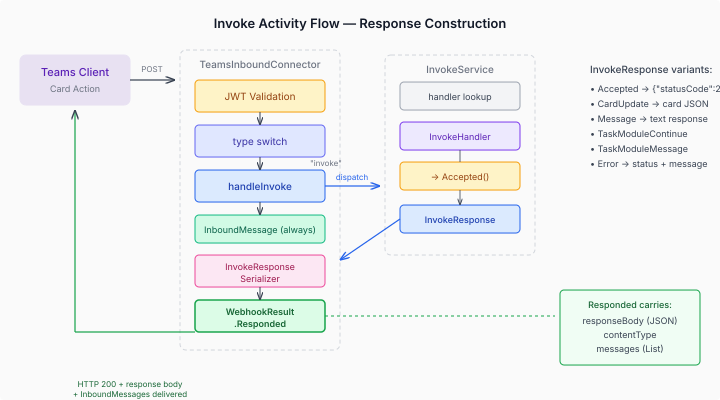

# When the Card Talks Back

Every activity type the Teams connector handles — messages, reactions, conversation updates — works the same way. The activity arrives, we parse it, fire an `InboundMessage`, return HTTP 200 with an empty body. Bot Framework discards the response body for all of these. The connector is pure infrastructure: data in, event out, nothing interesting on the return path.

Invoke activities break that model. When a user clicks an Approve button on an Adaptive Card, or submits a task module form, the HTTP response body is the *only mechanism* to update what they see. Return `{"statusCode":200}` and the card stays unchanged. Return a replacement card and the UI updates inline. There's no outbound API call, no follow-up message, no alternative path. The response IS the interaction.

This creates a tension with the library's core principle — pure delivery infrastructure. The connector doesn't own business logic. But the response body determines what the user sees next, and that's inherently a business decision. Who constructs it?

## The handler pattern

The same structural problem exists for commands. `CommandService` discovers `CommandHandler` beans at startup, dispatches by command name, and uses the return value. The command connector owns the transport; the handler owns the response. `InvokeHandler` follows the same shape.

```java
public interface InvokeHandler {
    String name();
    InvokeResponse handle(InvokeRequest request);
}
```

A handler registers for a specific invoke name — `adaptiveCard/action`, `task/fetch`, `task/submit` — and returns a typed response. `InvokeService` discovers them through CDI, dispatches by name, catches exceptions, and falls back to `Accepted()` when no handler exists or when one fails. The connector delivers the `InboundMessage` regardless. If nobody cares about invoke activities, they arrive as events and get a silent acknowledge. If someone does care, they wire up a handler and control the response.

## Two envelopes, one webhook

The response format depends on what kind of invoke activity arrived, and the two schemas are structurally incompatible. Adaptive Card actions use a flat envelope with `statusCode`, `type`, and `value`. Task module responses wrap everything in a `task` object with `type: "continue"` or `type: "message"`.

A raw string return type would let handler authors construct any JSON they want — including invalid JSON that Teams would reject silently. `InvokeResponse` is a sealed interface instead, with variants that map to exactly one valid Bot Framework schema each.

```java
public sealed interface InvokeResponse {
    record Accepted() implements InvokeResponse {}
    record CardUpdate(String cardJson) implements InvokeResponse {}
    record Message(String text) implements InvokeResponse {}
    record TaskModuleContinue(String title, String cardJson) implements InvokeResponse {}
    record TaskModuleMessage(String text) implements InvokeResponse {}
    record Error(int statusCode, String message) implements InvokeResponse {}
}
```

The connector owns `InvokeResponseSerializer`, which pattern-matches the sealed type exhaustively and builds the correct JSON. Handlers work with typed Java. The serializer ensures the response Teams receives is structurally valid. If Bot Framework adds a new response type in the future, a new variant forces a compile error in the serializer — same design philosophy as `WebhookResult` itself.

## The sixth variant

`WebhookResult` is a sealed interface with five variants. Every variant either delivers messages (`Delivered`, `DeferredDelivery`) or returns a response body (`Challenged`), but never both. Invoke activities need both. `Responded` is the sixth variant — it carries a response body, a content type, and a list of `InboundMessage`s. The router delivers the messages to observers and returns the body to the caller in one operation.



The sealed type forces an exhaustive switch update in `WebhookRouter`. This was the design intent from the start — the original `WebhookResult` Javadoc says "making it impossible to add a new result variant without updating the router." Adding `Responded` proved it works: the compiler caught the incomplete switch immediately.

## Why Discord did it differently

Discord slash commands also need HTTP response bodies — type 4 for immediate response, type 5 for deferred. But Discord uses a separate `DiscordInteractionEndpoint` JAX-RS endpoint rather than extending the webhook connector. The reason is architectural: Discord's interaction API is a fundamentally different entry point from its Gateway WebSocket, with its own auth (Ed25519 signatures), its own URL (`/interactions/discord`), and no connection to the inbound connector that listens on the Gateway.

Bot Framework routes everything through one webhook. Messages, reactions, conversation updates, invoke activities — they all arrive at the same URL with the same JWT auth. Splitting invoke activities to a separate endpoint would duplicate all the auth and routing infrastructure for no gain. The webhook connector is the right home.

## The guard that matters

One subtlety caught during code review: if an `InvokeHandler` returns `CardUpdate` with malformed JSON, the serializer would throw, the exception would propagate to the catch-all in `handle()`, and the connector would return `Ignored()`. That means the `InboundMessage` — already constructed — would never be delivered. A handler's formatting mistake would silently kill the delivery infrastructure's obligation.

The fix is a targeted try-catch around serialization that falls back to `Accepted()` while preserving the message delivery. The handler's error gets logged; the user sees an acknowledged action; the downstream observer still gets the event. Defence in depth — the infrastructure honours its contract even when a consumer makes an error.
