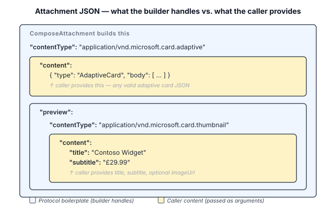
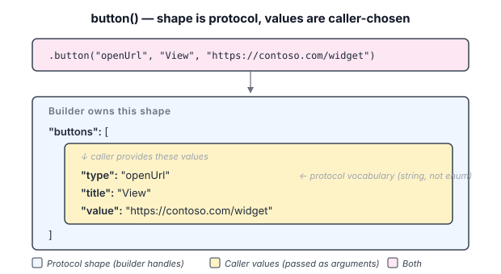

# The Line Between Raw and Ready

When we built the messaging extension dispatch, the attachment model was deliberately raw. `ComposeResult` takes `List<String>` — each string is a complete attachment JSON blob. The caller constructs it however they want. No types, no builders, no opinions. This was the right call for a connector library that sits at the infrastructure layer: the moment you model card structure, you're making decisions about content, and content isn't your job.

But every consumer building a search extension hits the same wall. The Bot Framework attachment envelope has a fixed shape — a `contentType` string that's always the same, a `content` object holding the adaptive card, and an optional `preview` block with its own `contentType`, `title`, `subtitle`, and `images` array. None of that is caller content. It's protocol boilerplate that every extension repeats identically.

The friction shows up immediately in test code, which is a reliable signal:

```java
String att = "{\"contentType\":\"application/vnd.microsoft.card.adaptive\","
    + "\"content\":{\"type\":\"AdaptiveCard\"},"
    + "\"preview\":{\"contentType\":\"application/vnd.microsoft.card.thumbnail\","
    + "\"content\":{\"title\":\"Result 1\"}}}";
```

That's not someone expressing a domain concept. That's someone transcribing a protocol by hand.

## Where the line sits

The interesting design question isn't whether to add a builder — it's where the builder stops. `ComposeAttachment.adaptive()` takes the card JSON as an opaque string and wraps it in the protocol envelope. The preview is optional — `.preview("Title", "Subtitle")` or `.preview("Title", "Subtitle", imageUrl)`. The output is a JSON string that plugs directly into `ComposeResult`'s `List<String>`.

```java
return new InvokeResponse.ComposeResult("list", List.of(
    ComposeAttachment.adaptive(card1).preview("Contoso Widget", "£29.99").build(),
    ComposeAttachment.adaptive(card2).preview("Northwind Gadget", "£49.99").build()
));
```

The builder handles everything the protocol dictates — `contentType` values, the envelope nesting, the thumbnail preview structure. The caller provides everything that varies — the card body and the preview metadata. The raw `List<String>` contract on `ComposeResult` doesn't change, so any consumer that prefers hand-crafted JSON can still use it.



The boundary is clean because it tracks a real distinction: protocol structure vs. caller content. If the builder had tried to model the adaptive card body — text blocks, images, actions — it would have crossed into content territory. The card body is the caller's business. The attachment envelope is the protocol's.

## Progressive disclosure

Hero and thumbnail cards follow the same principle at a smaller scale. `ComposeAttachment.hero(title, subtitle, imageUrl)` builds a standalone hero card — no adaptive card body, no preview layer, just the card type and its three fields.

The 3-arg form shipped first because it's the complete specification. But most hero cards in practice don't use all three arguments. A search result heading needs a title. A product listing needs title and price. The image is the rarer case, not the common one.

```java
ComposeAttachment.hero("Search Result").build()
ComposeAttachment.hero("Contoso Widget", "£29.99").build()
ComposeAttachment.hero("Contoso Widget", "£29.99", imageUrl).build()
```

Each overload delegates to the 3-arg form — the same `CardBuilder`, the same JSON envelope, the same protocol mechanics. The API surface grows without widening the builder's boundary. What changes is the noise at the call site: a title-only hero card no longer carries two trailing `null` arguments that mean nothing to the reader.

This is a general pattern worth naming. Ship the full-spec form first — it's correct and complete. Then add the progressive overloads once you can see what callers actually need. The overloads are cheaper to get right because the full-spec form already handles all the edge cases. They just peel off the common shapes.

## Buttons and the boundary within a call

Hero and thumbnail cards in Bot Framework also support action buttons — an array of `CardAction` objects, each with a `type`, `title`, and `value`. The shape is protocol structure. The values are caller content. The boundary runs through a single method call.

```java
ComposeAttachment.hero("Contoso Widget", "£29.99")
    .button("openUrl", "View", "https://contoso.com/widget")
    .button("imBack", "Buy", "buy-widget-123")
    .build()
```

The JSON envelope — an array called `buttons`, each element an object with three keys — is what every caller would construct identically. That belongs in the builder. But the button types (`openUrl`, `imBack`, `messageBack`, `invoke`) are protocol vocabulary the caller selects, not protocol boilerplate the builder can hard-code. So they stay as strings, not an enum.

This is a deliberate trade-off. An enum would catch typos at compile time, but it would also couple the builder to a snapshot of Bot Framework's action type list. When Microsoft adds a new action type, every consumer would need to wait for us to update the enum. A string means forward compatibility at the cost of a runtime error on typos — a cost that's real but far cheaper than a maintenance bottleneck.



The broader point: a clean protocol boundary doesn't always divide neatly at the method level. Sometimes the builder owns the shape of a structure while the caller owns what goes into it. The question isn't "does the builder handle this feature or not?" It's "what part of this feature is the same for every caller, and what part varies?"

## Reference handlers

Four reference `InvokeHandler` implementations sit alongside the builder in `chat-teams`. Each one is under 30 lines. `RefSearchHandler` returns three canned search results with thumbnail previews. `RefLinkUnfurlHandler` returns a single unfurl card without a preview. `RefFetchTaskHandler` returns a task module form via `ComposeContinue`. `RefSubmitActionHandler` returns a confirmation card with a preview.

They follow the same pattern as `chat-ref`, `bank-ref`, and the other reference implementations — in-memory, no external dependencies, hard-coded responses. The difference is that `InvokeHandler` is Teams-specific, not a cross-platform SPI, so the reference handlers live directly in `chat-teams` rather than a separate module.

The handlers are the first real consumers of `ComposeAttachment`, and the code reads the way a consumer's code should read — the protocol mechanics are invisible, the card content and preview metadata are front and centre. That's what a convenience layer is for: not hiding complexity, but separating what varies from what doesn't.

## The design observation

"Raw for flexibility" and "builder for convenience" are not in tension when the boundary tracks a real concern split. The test is simple: does the builder make decisions the caller should be making? If yes, it's crossed into domain territory. If it only handles things the caller would always do identically, it's infrastructure helping with infrastructure.

`contentType: "application/vnd.microsoft.card.adaptive"` is something every caller types exactly the same way. That's the builder's job. The card body is something every caller builds differently. That stays a string.
