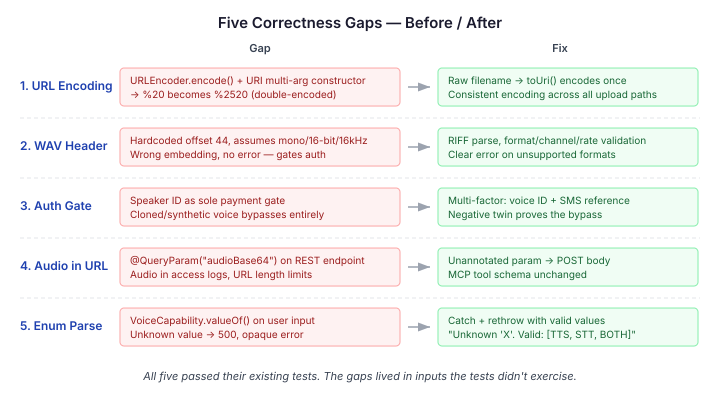

# Five Gaps Nobody Noticed

Infrastructure libraries have a specific failure mode: everything works, so nobody looks. The happy path passes, the tests are green, the API consumers ship their features. Meanwhile, a filename with a space gets double-encoded, a compressed WAV file produces a garbage embedding with no error, and audio data lands in URL query strings where server access logs record every byte.

We cleared five of these from the connectors library today. None were reported by consumers. All were found by auditing the code paths that run when inputs aren't perfectly clean.

## The Percent That Wasn't

`MicrosoftDriveClient` encoded upload filenames with `URLEncoder.encode()` — a method designed for HTML form data, not URL paths. For simple uploads, the result was passed to `URI.create()`, which treats percent-encoded sequences as already encoded. No double encoding, correct by accident.

But resumable uploads route through `MicrosoftGraphClient.post()`, which calls `toUri()` — a method that constructs a `URI` via the multi-argument constructor. That constructor re-encodes path components. `%20` becomes `%2520`. A space in a filename turns into a literal `%20` in the stored file name on OneDrive.

The fix removed `URLEncoder` entirely and let `toUri()` handle encoding from raw filenames. The interesting part: `toUri()` was already doing the right thing for every other path in the codebase. The upload methods were the only callers that pre-encoded, because they predated `toUri()` and built their own URIs.

Graph API accepted the double-encoded names without complaint. The tests passed. The bug only surfaces when a consumer downloads a file they uploaded and the name doesn't match.

## Forty-Four Bytes of Assumption

`SpeakerPlugin.extractFromWav` assumed every WAV file has a 44-byte header, 16-bit mono samples at 16 kHz. If you gave it stereo audio, it would dutifully read alternating left-right samples as a single stream and produce an embedding. If you gave it 44.1 kHz audio, it would tell the extractor the sample rate was 16 kHz. No error, no warning — just a wrong embedding used to gate an authorisation.

WAV files are RIFF containers. The data doesn't start at byte 44 — it starts wherever the `data` chunk is, which depends on what other chunks (metadata, cue points, playlists) appear between `fmt` and `data`. The fix parses the RIFF structure properly: validate the header magic, read format fields from the `fmt` chunk, scan forward to find `data`, and reject anything that isn't PCM mono 16-bit at 16 kHz.

Two additional gaps fell out of code review: no check for the PCM audio format field (compressed WAV would pass validation), and `findDataChunk` could loop forever on a malformed file with a negative chunk size.

## The Gate That Wasn't

The voice playbooks demonstrated speaker identification as the sole gate for payment authorisation. Register a voiceprint from TTS audio, speak a confirmation, identify the speaker, authorise the payment. The identification works — the ref implementation correctly matches embeddings. But TTS voices are the known weakness of voice biometrics. A cloned voice passes this gate.

The fix adds a second factor: an SMS reference number that the speaker must include in their verbal confirmation. The compliance reviewer verifies both voice identity and reference number presence before releasing the payment. The playbook now declares the constraint as a rules header — `speaker identification alone does not authorise a payment` — and a negative twin demonstrates what happens when only voice ID is used.

This is a pattern worth generalising. Any playbook that gates a consequential action on a single biometric should have a negative twin showing the bypass.

## Audio in the Address Bar

`ConnectorVoiceApi.transcribe` accepted audio as a base64 query parameter. For the MCP tool surface this is fine — tool arguments aren't URLs. But the same method has a REST projection at `/api/connectors/voice/transcribe`, and `@QueryParam("audioBase64")` puts the entire audio payload in the URL. Server access logs record request URIs. Load balancers enforce URL length limits. The audio ends up where it shouldn't be.

The fix is one annotation removal — dropping `@QueryParam` from `audioBase64` lets the framework place it in the POST body, following the same pattern as `ConnectorDocumentApi.uploadFile`. The parameter itself, the method signature, and the MCP tool schema are unchanged.

In the same method's neighbourhood, `VoiceCapability.valueOf()` on user-supplied strings throws `IllegalArgumentException` with a message like "No enum constant io.casehub.connectors.voice.model.VoiceCapability.NONEXISTENT" — a 500 that should be a 400. The fix catches it and rethrows with the valid values listed.

## What These Share

Each of these bugs had tests that passed. The tests verified the happy path — standard filenames, well-formed WAV, single-factor auth, small payloads, known enum values. The bugs lived in the gap between what the tests covered and what the code accepted.

Infrastructure libraries are particularly susceptible because their consumers rarely control the inputs. A filename comes from a user. Audio comes from a microphone. A capability filter comes from an LLM tool call. The library's job is to handle the full input space, not just the slice its tests exercise.

