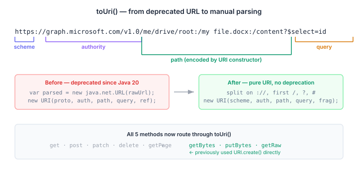

# Deprecation, Encoding, and Cloned Voices

Five fixes across three modules today, each small enough to land in one session but each touching something worth explaining.

## The URL That Wasn't

`MicrosoftGraphClient.toUri()` had a quiet problem: it used `new java.net.URL(rawUrl)` to parse a URL string into components, then fed those components into the multi-arg `URI` constructor for proper encoding. The `URL(String)` constructor has been deprecated since Java 20 and is flagged for removal. On a Java 26 JVM, it still works — until it doesn't.

The replacement is a manual string split. No library, no helper class — just `indexOf("://")`, find the first `/` after the authority, check for `?` and `#`, and hand the five components to `new URI(scheme, authority, path, query, fragment)`. The multi-arg `URI` constructor does the encoding — spaces become `%20`, percent signs get double-encoded — which is exactly why `toUri()` exists in the first place. A file called `my file.docx` in a OneDrive path needs encoding before it hits the wire.



The interesting part was what happened next. With `toUri()` fixed, three other methods turned out to be bypassing it entirely. `getBytes()`, `putBytes()`, and `getRaw()` all used `URI.create(BASE_URL + path)` — which throws `IllegalArgumentException` on unencoded spaces and misinterprets `?` as a query delimiter in filenames. Every other method in the class already routed through `toUri()`. These three were just missed when the method was introduced. One line each.

`getBytesFromUrl()` correctly stays on `URI.create()` — it takes absolute CDN URLs from redirect responses, already well-formed. Same for pagination cursors in `getPage()`. The rule is simple: paths from callers go through `toUri()`; URLs from APIs stay as-is.

## Configurable Sample Rates

`SpeakerPlugin.extractFromWav` had a hardcoded `if (sampleRate != 16000)` check that rejected everything except wideband telephony audio. The underlying `SpeakerEmbeddingExtractor` SPI already accepts a `sampleRate` parameter — the validation layer was more restrictive than the interface it feeds.

Real voice systems span 8 kHz (G.711 telephony) to 48 kHz (studio recording). The fix adds an `@Optional List<Integer> supportedSampleRates` field to the plugin record, defaulting to `Set.of(16000)` when null. Backward compatible: existing playbooks that don't specify rates get the same validation as before. Playbooks that need telephony audio or studio recordings configure it:

```yaml
speaker register:
  name: Alice Smith
  audio: ${aliceSample.audio-data}
  supportedSampleRates: [8000, 16000, 48000]
```

The error message now lists the configured valid rates rather than just saying "expected 16000 Hz."

## The Cloned Voice Attack

The negative twin playbook `06b-sole-gate-insecure` existed to demonstrate that speaker identification alone is an insecure payment gate. But it only showed Alice registering and confirming as herself — proving single-factor bypass, not the actual attack.

We rewrote it to show the attack the multi-factor rule prevents. Bob registers his voiceprint with the `bm_daniel` TTS voice. An attacker — using the same `bm_daniel` voice, simulating a cloned voiceprint — speaks the payment confirmation. The speaker identification system matches the attacker as Bob. Payment authorised. No second factor to catch the impersonation.

The test asserts that the clone passes: `speakerId.identified = true`, `speakerId.name = Bob Smith`. That passing assertion IS the vulnerability. The corresponding secure playbook (06) requires both voice ID and an SMS reference number — the clone might fool the biometrics, but it can't produce the OTP.

## A Runtime Regression, Surfaced by Accident

While fixing the playbooks, we hit a wall: all 18 playbook integration tests started failing with `Unresolved variable 'audio.audio-data'`. The `capture:` directive, which stores a step's output under a named prefix, had stopped working.

The root cause turned out to be a platform runtime update. The `casehub-platform-yaml-step-runtime` SNAPSHOT jumped from 279 KB to 331 KB between November 16 and November 18. The variable scoping mechanism changed — `capture: audio` no longer creates an `audio` prefix in the step execution scope.

This isn't a playbook fix. The playbooks are correct per the documented API. It needs to be fixed upstream in the platform runtime. We filed the diagnosis and moved on — the separate `mobile-send-sms` parameter fix (`platform: ref` and `body` instead of the old `message`) is committed and correct regardless.

The accidental discovery is the value of running integration tests during unrelated work. The runtime regression was invisible until we happened to touch a playbook that exercised it.
