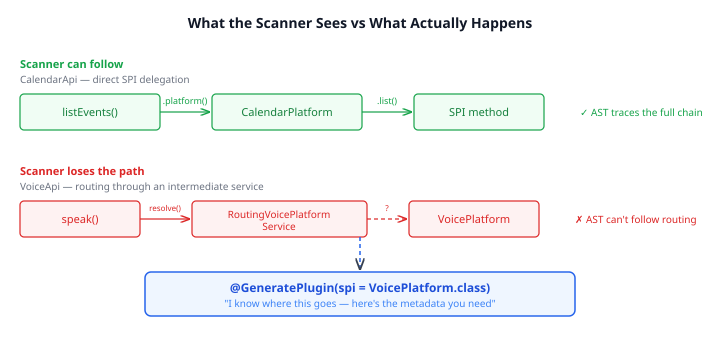

# The Pattern the Generator Couldn't Follow

The plugin generator walks the AST to find SPI relationships. For most connector domains this works: `CalendarApi.listEvents()` calls `calendarPlatformService.platform()`, which returns a `CalendarPlatform`, which has a `listEvents()` method. The chain is visible at compile time — the generator traces it, finds the SPI, and generates the right plugin wiring.

Voice breaks this. The `speak()` method doesn't call a platform service directly. It calls `resolveVoice()`, which calls `routingService.resolve(voice)`, which returns a `ResolvedVoice`, which has a `.platform()` accessor that returns a `VoicePlatform`. The generator sees the first hop — `resolveVoice()` — and finds a private method returning `ResolvedVoice`. That's not an SPI. The trail goes cold.



The routing exists for good reason. Voice needs smart dispatch: pick a platform by voice ID, by language preference, by query parameters, or fall back to a default. That logic lives in `RoutingVoicePlatformService`, not in the API method itself. The indirection is the feature. But the generator only knows what it can see in the syntax tree, and intermediate routing services are invisible to it.

The fix is an annotation — `@GeneratePlugin(spi = VoicePlatform.class)` — on each of the three voice methods. It tells the generator: this method delegates to `VoicePlatform`, regardless of how it gets there. The generator stops trying to trace the call chain and uses the declared SPI instead.

Messaging has a different problem. The three messaging methods — `sendEmail`, `sendSlack`, `sendTeams` — don't use the platform SPI pattern at all. They dispatch through `ConnectorService.send()`, the original outbound connector mechanism. It's a different architecture from the platform SPIs the generator was built to understand. Rather than teaching the scanner a second dispatch pattern for three legacy methods, we exclude them: `@GeneratePlugin(exclude = true)`.

```java
@GeneratePlugin(spi = VoicePlatform.class)
@PlatformMutation("Synthesise text to speech audio")
public VoiceSynthesisResult speak(...) {
    ResolvedVoice resolved = resolveVoice(voice, language);
    VoicePlatform platform = resolved.platform();
    // ...
}
```

Two kinds of gap, two kinds of annotation. `spi` says "I know the destination — here's the type." `exclude` says "this method doesn't fit your model — skip it." Both exist because the generator's AST inference, while powerful enough for straightforward delegation chains, can't follow every pattern that makes sense at runtime.

This is a general tension in any build-time tooling that needs to understand runtime behavior. Annotation processors, code generators, static analysers — they all hit the wall where the code's static shape diverges from its dynamic shape. The pragmatic answer is usually the same: don't make the runtime simpler to please the tooling. Give the tooling explicit metadata and let the runtime patterns be as rich as they need to be.
