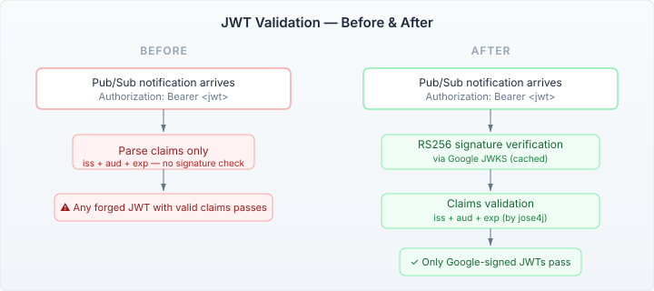
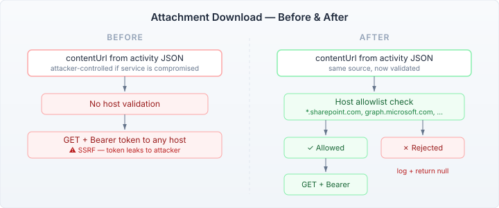

# The Things That Shouldn't Have Shipped

Eight fixes across four modules, and the common thread is uncomfortable: every one of these was a gap that existed in production code. Not hypothetical. Not "could theoretically." Reachable from real inputs that real callers would send.

The one that matters most is the Gmail push webhook. The connector was validating JWT claims — issuer, audience, expiry — but never verifying the signature. Any attacker who could reach the endpoint could forge a JWT with the right claims and trigger message fetching. The claims check felt like security. It wasn't.



The fix extracts JWT validation into a `JwtValidator` SPI and adds `GoogleOidcJwtValidator`, which uses jose4j to verify RS256 signatures against Google's JWKS endpoint with built-in key caching. The SPI design matters here: the connector doesn't know or care how verification works, and the CDI producer returns a pass-through lambda when no audience is configured (dev/test mode). In production, every JWT is signature-verified against Google's published keys before a single Gmail API call is made.

```java
public GoogleOidcJwtValidator(String expectedAudience) {
    this(expectedAudience,
         new HttpsJwksVerificationKeyResolver(
             new HttpsJwks(GOOGLE_JWKS_URL)));
}
```

jose4j handles the JWKS caching internally — keys are fetched once, cached by key ID, and refreshed when an unknown key ID arrives. No custom cache code needed.

The Teams work was a different kind of gap. Personal 1:1 channels use a `personal:conversationId` format, but several operations — `listMembers`, `listMessageHistory`, and all three reaction methods — blindly called `parseTeamAndChannel()`, which expects `teamId:channelId`. The result was either an `IllegalArgumentException` or a Graph API call with "personal" as the team ID, neither of which produces anything useful.

The fix is graceful degradation: personal channels return empty results for operations that don't apply to 1:1 chats. Members of a 1:1 chat? Empty list. Message history via Graph API for a Bot Framework conversation? Empty list. Reactions on a personal message? No-op. The pattern already existed for `sendMessage` and `replyToMessage` — these operations just hadn't been given the same treatment.

While I was in the Teams code, I fixed two more things. `BotFrameworkClient.sendToConversation` and `replyToActivity` both returned `void`, discarding the activity ID that the Bot Framework REST API actually sends back. Every personal send produced a `SendResult` with an empty string for `messageId`. Callers had no way to reference the message they'd just sent. Changing both methods from `void` to `String` and threading the ID through was straightforward — but it's the kind of thing that only surfaces when someone tries to reply to a personal message by ID and gets nothing.

The `htmlToMarkdown` fix is the smallest but the most satisfying to explain. The converter used `[^<]*` capture groups for tag content — `<b>([^<]*)</b>`. That regex cannot match `<b><i>text</i></b>` because the inner `<i>` terminates the `[^<]*` capture at position zero. Teams typically sends flat HTML, so this worked by accident. The fix is a single character class change: `[^<]*` becomes `.*?` (non-greedy). With that, the bold regex captures `<i>text</i>`, produces `**<i>text</i>**`, and the italic regex converts the inner tag in the next pass. `<b><i>text</i></b>` becomes `***text***` — bold italic in markdown.

The Google `NetHttpTransport` fix is the least interesting technically but the most telling about consistency. `GoogleCalendarPlatform` stored a `transport` field initialised in the constructor. `GoogleDocumentPlatform` and `GoogleEmailPlatform` created `new NetHttpTransport()` on every service accessor call. Same codebase, same team, same API — three different approaches. The fix aligns all four Google platform classes on the same pattern: constructor-initialised field via `GoogleNetHttpTransport.newTrustedTransport()`.

The eighth fix stayed in the Teams code. `BotFrameworkClient.downloadAttachment` takes a `contentUrl` from the Bot Framework activity JSON and fires an authenticated GET — Bearer token and all — without checking where it's pointing. The URL comes from Microsoft's service, so the risk is low in normal operation. But defense-in-depth says validate anyway: if the service is ever compromised or a crafted activity reaches the endpoint, that Bearer token goes wherever the attacker tells it to.



The pattern already existed in `DiscordClient.downloadAttachment`, which checks attachment URLs against an allowlist of known Discord CDN hosts before making a request. The Teams fix follows the same approach: a configurable `attachment-url-allowlist` with wildcard support (`*.sharepoint.com`, `graph.microsoft.com`, `*.botframework.com`), validated before the HTTP client opens a connection. Invalid URLs, null hosts, `file://` schemes — all rejected with a warning log.

The interesting part came during review. Adding the host check surfaced two more gaps that the Discord implementation already handles: there's no request timeout (a slow server in the allowlist hangs the thread), and no size limit (the response is buffered into a byte array with no cap — a multi-GB response from an allowed host means OOM). Discord uses `BodyHandlers.ofInputStream()` with a streaming byte counter that aborts at 8MB. The Teams implementation still uses `BodyHandlers.ofByteArray()`. Each gap was straightforward enough once spotted, but neither was visible until the SSRF work forced a side-by-side comparison with the Discord equivalent.

What connects these eight fixes is that none of them were caught by the type system. The JWT gap passed compilation. The personal channel crash passed compilation. The empty messageId passed compilation. The regex worked for every test case that happened to use flat HTML. The unvalidated download URL type-checked as a perfectly valid `String`. Static analysis won't find "you're checking claims but not signatures" or "you're sending a Bearer token to an unvalidated host." These are semantic gaps — the code does what it says, but what it says isn't what it should mean.
