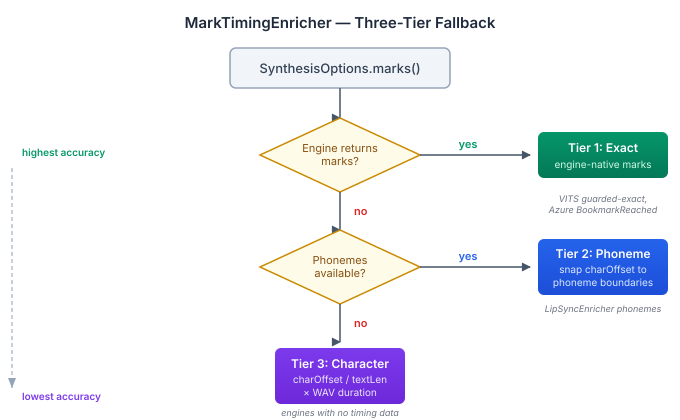
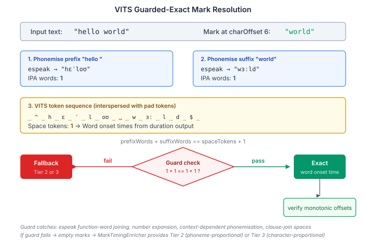

# The Word the Gesture Needs

An avatar that gestures while speaking needs to know when specific words start. Not approximately — a hand wave that arrives 300ms after the word "hello" looks like a nervous tic, not a greeting. The TTS engine knows exactly when each word begins in the audio buffer it just produced. The animation system knows exactly how long its gesture clips take to reach the stroke. Neither has access to the other's information.

The standard TTS abstraction for this is mark timing — SSML's `<mark>` element, Azure's `BookmarkReached` event, Google's timepoints, Polly's speech marks. The caller places marks at character positions in the input text; the engine returns the corresponding time offsets in the synthesised audio. It's a well-established pattern, but most SPI abstractions skip it because they're built for audio output, not multimodal synchronisation.

## The ownership split

The design divides cleanly along a data-ownership boundary. The server owns speech time — word onsets are a byproduct of synthesis that only the TTS engine can compute. The client owns animation time — stroke offsets are per-clip metadata that only the animation system knows. Neither side can compute the other's contribution.

This means the bridge has to be in the SPI. If mark timing lived in a higher layer — say, in the speech WebSocket server that streams audio to clients — it would need to either duplicate the TTS engine's phoneme analysis or invent a protocol for engines to push timing data upward. Both approaches leak engine-specific details into the wrong layer. The SPI already carries phoneme timings for lip sync. Marks are the same concept at word granularity.

The SPI change is small. Two new records:

```java
record TextMark(String id, int charOffset) {}
record MarkTiming(String id, long offsetMs) {}
```

`SynthesisOptions` gains a `marks` field — the caller says "I need timing for the word at character offset 6, call it `world`." `SynthesisResult` gains a `marks` field — the engine responds "mark `world` starts at 523ms in the audio buffer." Buffer time, unscaled — playback rate is the client's concern.

## Three tiers of accuracy

Not every TTS engine can compute exact mark timings. A cloud API with word-boundary events can. A local VITS model with access to its own duration output can, with careful phoneme counting and a consistency guard. An engine that returns nothing but audio bytes cannot.

The `MarkTimingEnricher` decorator handles this gracefully, the same way `LipSyncEnricher` handles missing phoneme data. It wraps any `TextToSpeech` implementation and provides two fallback tiers when the engine returns no marks:



**Tier 1 — engine-native (exact).** The engine computes mark timings directly from its synthesis process. VITS/Piper can do this by phonemising each mark's text prefix with espeak, counting IPA words, and indexing into the space-token boundaries of the duration output. A consistency guard verifies the word counts balance and that offsets are monotonic — if the guard fails, that segment falls back to Tier 2.

**Tier 2 — phoneme-proportional.** For engines that return phoneme timings (via `LipSyncEnricher` or natively) but no word boundaries. Each mark's character offset maps proportionally through the phoneme sequence, then snaps to the nearest phoneme start. This preserves the non-linear timing of actual speech — a long vowel takes more time than a short stop, and the mark lands on a real phoneme boundary rather than drifting into the middle of one.

**Tier 3 — character-proportional.** The last resort. No phonemes, no word boundaries — just the WAV duration and the character offsets. Each mark's offset is `charOffset / textLength × durationMs`. Crude, but better than nothing, and monotonic by construction.

## Why the decorator pattern

The enricher follows the same pattern as `LipSyncEnricher` — a decorator that wraps a `TextToSpeech` delegate and fills in missing data. If the delegate already provides marks, it passes through untouched. If not, it falls back through the tiers.

This matters because it makes mark timing opt-in without engine changes. An engine that already computes exact marks just returns them and the enricher does nothing. An engine that doesn't needs zero modifications — wrap it, and the fallback tiers provide the best timing the available data can support.

The two enrichers compose. `LipSyncEnricher` can wrap the raw engine to provide phoneme timings, and `MarkTimingEnricher` can wrap the result to provide mark timings from those phonemes. Each decorator handles one concern.

## Inside the VITS guarded-exact path

The interesting tier is Tier 1 — the one that knows exactly when each word starts because it was there when the model decided. VITS/Piper models produce a duration output alongside the audio: one value per token, telling the model how many frames to allocate. Space tokens in the IPA sequence correspond to word boundaries. The onset time of word N is the cumulative duration up to the N-th space token.

The challenge is mapping character offsets in the input text to word positions in the model's token sequence. espeak phonemises "hello world" into something like `hɛˈloʊ wɜːld` — two IPA words separated by a space. For a mark at character offset 6 (the start of "world"), we phonemise the prefix "hello " with espeak and count one IPA word. That count indexes directly into the space-token boundaries from the duration output.



The consistency guard is what makes this honest rather than optimistic. For every mark, we phonemise both the prefix and the suffix independently, then verify: `prefixWords + suffixWords == spaceTokens + 1`. If espeak phonemises the full text differently from the parts — joining function words, expanding numbers, treating a clause boundary as a word boundary — the word counts won't balance and the guard fails. When it fails, the segment returns empty marks and `MarkTimingEnricher` provides the Tier 2 or Tier 3 fallback. The guard also rejects non-monotonic offsets.

This catches exactly the cases where "exact" would be a lie: context-dependent phonemisation where espeak produces different word structures for the same text depending on surrounding context. Two extra espeak calls per mark — cheap compared to VITS inference.

## Testing without native dependencies

The ref implementation provides a parallel path for integration tests. It doesn't have espeak or a duration model, so it uses a synthetic 50ms-per-character duration and returns character-proportional marks directly. This lets tests verify the full mark-timing contract — SPI, enricher pass-through, result serialisation — without provisioning native libraries. The VITS integration tests, gated by `@EnabledIf("allDepsAvailable")`, cover the real espeak path separately.

## What this unblocks

With mark timings available through the SPI, the agency repo's avatar animation system can schedule gesture triggers as `max(0, offsetMs / rate − strokeMs(clip) − crossfade / 2)`. The server provides `offsetMs`. The client provides `strokeMs` and `rate`. The gesture lands on the word it was meant for.
