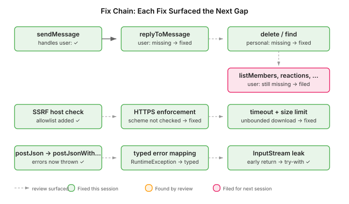

# The Same Gap, Twelve Times

Twelve fixes on the same branch, and the uncomfortable pattern is that most of them were copies of bugs already fixed elsewhere. Not new categories of failure — the same category, repeated in adjacent operations. The `user:` channel prefix was handled in `sendMessage` but not `replyToMessage`. `isPersonalChannel()` guards existed on reactions and members but not on `delete` and `find`. SSRF defense checked the hostname but not the scheme. The error path threw but threw `RuntimeException` instead of the typed hierarchy that everything else uses.

Each fix forced a scan of the surrounding code. Each scan found another instance.



## The prefix that slipped through

Teams channels use prefixes to distinguish channel types: `team-1:19:ch@thread.tacv2` for team channels, `personal:conversationId` for 1:1 chats, `user:aadObjectId` for proactive messages. `sendMessage` handled all three. `replyToMessage` handled two — `personal:` through `BotFrameworkClient.replyToActivity()`, team channels through Graph API. A `user:` prefix fell through to `parseTeamAndChannel()`, which split on `:` and tried to use `"user"` as a team ID.

```java
if (isUserChannel(parent.channel().id())) {
    return replyToUserChannel(
        extractAadObjectId(parent.channel().id()), parent, content);
}
```

The fix mirrors `sendProactiveMessage` — resolve the AAD object ID to a conversation via the reference store (or cold-start create), then reply. The resolution logic is duplicated, which is a code smell worth extracting later, but the defensive fix comes first.

Reviewing that change surfaced the same gap in `ChannelManagement.delete()` and `find()` — both called `parseTeamAndChannel()` without checking `isPersonalChannel()`. Then reviewing *that* fix surfaced the same gap in `listMembers`, `listMessageHistory`, all three reaction methods, and both member management operations — but only for `user:`, not `personal:`. Three concentric rings of the same latent crash.

## Graph path delimiters

Microsoft Graph API uses `:/path:/` notation for drive-item paths: `/me/drive/root:/Documents/file.docx:/content`. If a filename contains `#` or `?` — `report#1.docx`, `Q&A notes.docx` — the URI parser treats them as fragment and query delimiters.

The fix is structural rather than escape-based: find where the last `:/` closes, and only look for `#` and `?` *after* that boundary.

```java
private static int graphPathEnd(String rest) {
    int searchFrom = 0;
    int lastEnd    = 0;
    while (true) {
        int start = rest.indexOf(":/", searchFrom);
        if (start < 0) break;
        int end = rest.indexOf(":/", start + 2);
        if (end < 0) break;
        lastEnd    = end + 2;
        searchFrom = lastEnd;
    }
    return lastEnd;
}
```

Two characters of change in the caller — `rest.indexOf('#')` becomes `rest.indexOf('#', safeFrom)` — but those two characters represent the difference between "this is a URI delimiter" and "this is a filename character." The multi-arg `URI` constructor handles the encoding; we just had to stop splitting before the constructor got its chance.

## Bearer tokens over plaintext

The SSRF defense from the previous session checked hostnames against an allowlist but accepted any scheme. `http://graph.microsoft.com` passed the host check and sent the Bearer token unencrypted. Four characters — `"https".equalsIgnoreCase(uri.getScheme())` — but the kind that matter at 3am when someone asks how the token leaked.

The same review pass also moved from `BodyHandlers.ofByteArray()` to `BodyHandlers.ofInputStream()` with a streaming byte counter that aborts at 8MB, matching the Discord client's existing pattern. And it moved the status-code check and Content-Length check inside the `try-with-resources` on the response body — the original code returned `null` on non-200 without closing the stream.

## The error that lost its type

`BotFrameworkClient.postJsonWithResponse` caught non-2xx responses and threw `RuntimeException`. The rest of the connector stack uses `ProviderApiException` with subclasses for 429 (rate-limited) and 401/403 (auth failure). One line changed:

```java
throw ProviderErrorMapping.mapStatusCode(
    response.statusCode(), response.body(), "microsoft-bot", null);
```

Callers that catch `ProviderRateLimitedException` to implement backoff now work for Bot Framework calls, not just Graph API calls.

## What connects them

None of these were exotic failures. They were the mundane kind — the guard that covered eight operations but not the ninth, the scheme check that was implicitly assumed but never enforced, the error type that was correct in one client but not its sibling. The pattern isn't "our code has bugs." It's that defensive fixes travel in clusters, and the fix for one operation is a search warrant for every adjacent operation that touches the same path.

The htmlToMarkdown multi-pass fix and the CDI qualifier on `JwtValidator` round out the set. Same-tag nesting (`<b>a <b>inner</b> outer</b>`) needed a loop-until-stable because non-greedy `.*?` only peels the innermost pair per pass. The `@Named("gmail-push")` qualifier on the JWT validator producer is preventive — only one producer exists today, but a second `JwtValidator` for a different webhook would trigger an ambiguous dependency error at boot with no hint about what went wrong.

Twelve fixes, one real insight: treat every fix as evidence that the same gap exists somewhere nearby.
