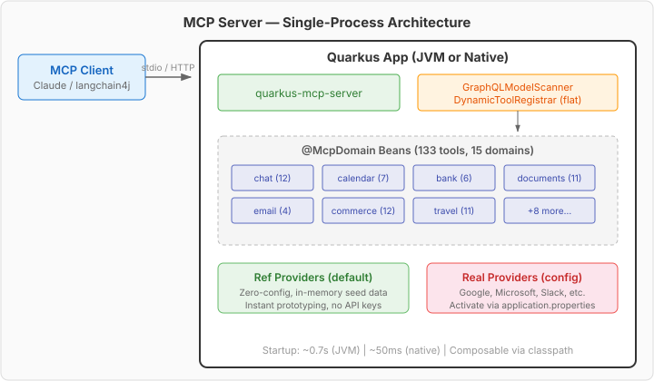

The connectors project has accumulated 90+ MCP tools across 13 platform domains — calendar, email, documents, chat, commerce, travel, health, voice, mobile, the lot. These already work inside the full CaseHub platform. The question we set out to answer today: can we package them as a standalone MCP server that any LLM agent framework can use? Claude Desktop, langchain4j, Cursor, OpenAI agents — whatever speaks MCP.

The answer is yes, and the journey to get there involved a design pivot I didn't expect.

## The two-process plan that didn't survive contact

I went in with a clear architecture: a GraalVM native proxy for instant startup, proxying to a JVM backend for the full provider stack. The native proxy would serve `tools/list` from a build-time catalog in milliseconds. The JVM backend would start behind it, loading Google's reflection-heavy client libraries and CDI at its own pace. Ref implementations would serve as warmup fallback until real providers were ready. Unix domain socket between them. Proxy manages the backend lifecycle.

It was a coherent design. Nine decisions captured, all pointing the same direction. Then Claude ran a light decision review and came back with a factual correction that collapsed the whole thing: Quarkus ArC is native-image-safe. ArC does all CDI bean discovery and wiring at build time. Every Quarkus native image uses ArC. The stated reason for a separate CDI-free proxy — "CDI can't go native" — was wrong.

That one correction superseded five of nine decisions. No proxy. No IPC. No process management. No warmup fallback. No dual-mode complexity. Just a single Quarkus app with two build outputs: JVM JAR (all providers, 0.7s startup) and native binary (native-ready providers only, millisecond startup).

The lesson is old but worth re-stating: the most valuable review finding isn't the one that improves a design — it's the one that removes the need for the design entirely.

## What we actually built

The standalone server is two new modules plus a handful of changes to existing code:

**Platform side** — a `mcp-server` module providing an anonymous `CurrentPrincipal` for standalone use, a `DomainFilter` for explicit mode, and a "flat" tool registration mode. The existing `DynamicToolRegistrar` already knew how to register individual tools per domain via `casehub_activate` — the flat mode just does it for every domain at startup, automatically.

**Connectors side** — a `mcp-server-connectors` config module. It's a pom.xml, an `application.properties`, and a CDI producer class. No application code. `GraphQLModelScanner` discovers all `@McpDomain` beans on the classpath and `DynamicToolRegistrar` registers them as flat MCP tools. 133 tools across 15 domains, started in 0.7 seconds.

The composability model is the interesting part. The server is domain-agnostic — whatever `@McpDomain` JARs land on the classpath get exposed as tools. A connectors-only server, a neocortex-only server, or a combined server are all just different dependency sets. No code change, no configuration change. Add the JAR, the tools appear.

## CDI wiring: where the real work was

The design was quick. The implementation was dominated by CDI wiring — getting Quarkus to discover and satisfy all the right beans in a standalone context.

Three problems and their solutions:

**Problem 1: `ConnectorOperationsImpl` had a constructor CDI couldn't satisfy.** It took `List<Connector>` (CDI needs `@All List<Connector>`), `List<WebhookInboundConnector>` (same), and `Optional<SentMessageCapture>` (CDI doesn't inject `Optional` — needs `Instance<>`). Previously, `GraphqlBeans` had a `@Produces` method that did the conversion. But Quarkus was also discovering the class directly as a CDI bean (Jandex index + `@McpDomain`), creating two beans for the same type. Fix: add `@ApplicationScoped` and `@Inject` with CDI-compatible types on the constructor, add a package-private constructor for test use, delete `GraphqlBeans`.

**Problem 2: Quarkus ArC removes "unused" beans at build time.** The `@McpDomain` classes aren't injected by anything — they're discovered by `GraphQLModelScanner` via `BeanManager.getBeans()` at runtime. ArC couldn't see this usage and removed them. Fix: `quarkus.arc.unremovable-types=io.casehub.connectors.graphql.**`.

**Problem 3: `@McpServer("casehub")` on the platform's `CaseHubMcpTools` creates a named MCP server.** This conflicts with the standalone server's transport — stdio doesn't support multiple server configurations. Fix: `quarkus.arc.exclude-types` to remove the platform's dispatch-mode tools from the standalone server's CDI context.

None of these are architectural — they're integration friction. But they took more time than the design and the actual code changes combined.

## Ref providers as the killer feature

Every tool works out of the box with no API keys. The ref implementations serve realistic seed data — calendar events, email messages, bank transactions, medical records, product catalogues. A developer can connect an LLM agent to 133 tools in under a minute and start building conversation flows, testing tool selection, and prototyping workflows. When ready for production, they swap ref for real providers via `application.properties`. Same tools, same schemas, real data.

This zero-config prototyping story is what makes the standalone server immediately useful, rather than theoretically interesting.

## What's next: the connection homepage

The obvious gap is authentication for real providers. Google, Microsoft, GitHub — they all need OAuth2 tokens. The ref implementations sidestep this, but production use needs the user to sign in somewhere.

I want an MCP tool that opens a browser to a connection management page hosted by the server itself. Click "Connect Google", do the OAuth2 dance, tokens stored locally. No CLI flags, no config files, no client-specific integration. Any MCP client can trigger it because it's just a tool call that opens a URL. We filed this as a mosaic issue (casehubio/casehub-mosaic#328) since the UI components are shared with the platform's connection management work.

The other open item is stdio transport. The platform's `CaseHubMcpTools` declares a named MCP server (`@McpServer("casehub")`) that conflicts with stdio's single-server requirement. This needs a platform change to make the named server conditional — straightforward but needs coordination across repos.
