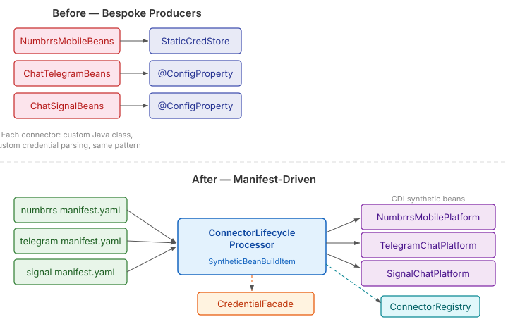

# The Manifest That Replaced the Beans

Every connector in the platform had a `*Beans.java` file. `NumbrrsMobileBeans` read credentials from a JSON blob in `StaticCredentialStore`, parsed them with Jackson, and produced CDI beans. `ChatTelegramBeans` did the same thing with `@ConfigProperty` annotations. `ChatSignalBeans` too. Three connectors, three files, same pattern — the only variation was which credential fields got wired into which constructor arguments.

I wanted to kill that pattern. Not refactor it, not abstract it — eliminate the entire category of code. A connector should declare what it needs, and the platform should wire it. No Java class required.

The answer is a YAML manifest. Each connector module drops a `connector-manifest.yaml` into `META-INF/`:

```yaml
connector:
  id: numbrrs
  platform: mobile
  auth:
    type: api-key
    fields:
      - name: api-key
        description: "Numbrrs API key"
      - name: signing-secret
        required: false
  produces:
    - class: ...NumbrrsMobilePlatform
      type: platform
      constructor-args:
        - field: api-key
        - field: numbers
```

The `produces` block is the interesting part. Each entry maps directly to a CDI bean — the `constructor-args` declare how to build it. `field:` resolves a credential from a `ProviderCredentialFacade`. `bean:` injects another CDI bean. Telegram's manifest chains both: the bot client takes a credential field, and the chat platform takes the client bean plus a token field. The build extension figures out the rest.



## The build extension

Claude and I built a Quarkus `ConnectorLifecycleProcessor` with three `@BuildStep` methods. The first discovers manifests from the classpath. The second walks each manifest's `produces` list and registers a `SyntheticBeanBuildItem` per entry — encoding the constructor arg spec as build-time parameters, then resolving credentials and injecting beans at runtime via a generic `ConnectorBeanCreator`. The third registers a `ConnectorRegistry` populated with every discovered connector and its configuration status.

The interesting constraint was qualification. I initially added `@ConnectorBean(id = "numbrrs")` as a qualifier on each synthetic bean. Quarkus needs to generate an annotation literal at build time for custom qualifiers, and it couldn't find the annotation class inside the test archive. Claude caught it in the first test run — `Annotation class not available: @ConnectorBean(id = "test-lifecycle")`. We dropped the custom qualifier entirely for now. Each connector produces distinct types, so `@Default` is sufficient. When disambiguation is needed, the custom qualifier can move to the lifecycle module where `jakarta.inject` is on the classpath.

The second surprise was `@PostConstruct`. Both `TelegramChatPlatform` and `SignalChatPlatform` use `@PostConstruct init()` to set up their capability interfaces — checking credentials, reaching out to health endpoints. The new manifest-driven constructors call `init()` directly. But Quarkus synthetic beans also invoke `@PostConstruct` after creation. Double initialisation — including a redundant health-check network call for Signal. We stripped `@PostConstruct` from both classes. The constructors own the lifecycle now.

## Three connectors, one week

Numbrrs was the cleanest migration: add a manifest, add a `(String, String)` constructor, delete `NumbrrsMobileBeans`. Seventeen tests passed without touching a single assertion.

Telegram needed more surgery. We stripped `@ApplicationScoped`, `@Inject`, and `@ConfigProperty` from the bot client, chat platform, and inbound connector. Along the way we caught a timing-vulnerable `String.equals()` on the webhook secret token and replaced it with `MessageDigest.isEqual()`.

Signal followed the same pattern. The CDI wiring integration test — which tested CDI infrastructure rather than Signal logic — was removed. That test belongs at the application level, not in the connector module.

The manifest files are framework-neutral YAML. The build extension is Quarkus-specific. The connector classes are plain Java with no CDI annotations. That separation is the whole point: the connector doesn't know how it's wired. It just declares what it needs.

The next piece is making this visible to agents. A `ConnectorRegistry` already tracks every discovered connector and whether its credentials are configured. The MCP tools to expose that — `connector_discover`, `connector_status` — are straightforward. The more interesting question is setup playbooks: Signal's phone registration requires receiving an SMS from Numbrrs, which means one connector's setup depends on another connector being operational. That cross-connector dependency is what the manifest's `setup-playbook` field is for.
