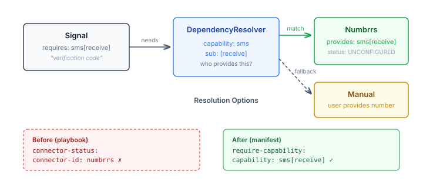

# What Do You Need?

Yesterday's manifest work killed the `*Beans.java` files — a connector declares what it produces in YAML, and the platform wires it. But `produces` is only half the picture. A connector also has prerequisites. Signal needs an SMS-capable number to receive a verification code during registration. That dependency was buried in a playbook step: `connector-status: connector-id: numbrrs, require: READY`.

That line is the problem. Signal doesn't need Numbrrs specifically. It needs SMS — the capability of receiving a text message at a phone number. Numbrrs is one provider that happens to offer it. Twilio is another. The user's own phone is a third. Hardcoding the provider name in the playbook couples two things that should know nothing about each other.

The fix is two new manifest fields: `requires` and `provides`.

```yaml
# Signal declares what it needs — never names a provider
connector:
  id: signal
  requires:
    - capability: sms
      sub: [receive]
      reason: "SMS verification code during registration"

# Numbrrs declares what it offers
connector:
  id: numbrrs
  provides:
    - capability: sms
      sub: [receive]
    - capability: number-info
```

The `sub` qualifier is important. Numbrrs receives SMS but can't send. If I'd modelled this as bare `sms` capability, it would falsely claim Numbrrs can do everything SMS-related. But send/receive is just one dimension — a capability could also vary by coverage, by number type, by country. Rather than baking a taxonomy into the naming scheme, `sub` lets you narrow along any axis. An unqualified `provides: [sms]` means full capability — it satisfies any qualified requirement.

## The Resolver

A `DependencyResolver` builds a provider index from all discovered manifests at startup. When something asks "what does Signal need?", it walks the requirements, checks which providers offer matching capabilities, and returns resolution options:



Every resolution includes a `ManualOption` — the user can always satisfy a requirement themselves. If you have your own phone number that receives SMS, you don't need to set up Numbrrs at all. The lifecycle system presents both paths: automated (set up a provider connector) or manual (handle it yourself).

The matching logic has one subtlety worth calling out. When a provider declares `sms` with no sub-qualifiers, that means "full SMS capability" — it satisfies `sms[receive]`, `sms[send]`, or any other qualified requirement. When a provider declares `sms[receive]`, it only satisfies requirements that ask for `receive` or a subset of it. A requirement for `sms[receive, send]` won't match a provider that only offers `sms[receive]`.

## From Declaration to Execution

The resolver on its own just answers questions. The `require-capability` playbook step makes it actionable — a `@Plugin` step type that calls the resolver at runtime:

```yaml
# Signal's registration playbook — before
- connector-status:
    connector-id: numbrrs
    require: READY

# After — capability-based, provider-agnostic
- require-capability:
    capability: sms
    sub: [receive]
```

When the step runs, it checks the resolver. If a provider is READY, the step succeeds and the playbook continues. If not, it returns structured resolution options — which providers exist, their status, their setup playbooks — so the runner can offer the user a choice: set up Numbrrs automatically, or provide your own number.

## The Bootstrap Primitive

This points toward a larger pattern. With nothing but SMS and email, you should be able to bootstrap every other service. Signal needs SMS. Some future service might need email verification. Each is a capability that can be provided by a dedicated connector or by the user directly. The dependency chains are short — typically one or two links — but they're real, and they need to be declarative and discoverable.

The resolver handles both primitives identically. A service that requires `sms[receive]` and `email[receive]` gets independent resolution for each — multiple providers can satisfy each capability, and the manual fallback is always available.

## Credentials Without the Chat Window

One problem remained: when the setup chain triggers "set up Numbrrs", the user needs to provide an API key. If they type it in the chat, it's in the conversation history — visible to the model, potentially cached and logged. Credentials should never flow through the LLM context.

The manifest now carries the guidance a user needs to find each credential:

```yaml
fields:
  - name: api-key
    description: "Numbrrs API key"
    help: "Find this in your Numbrrs dashboard at Settings → API Keys"
    example: "nmbr_sk_1a2b3c4d5e6f"
```

Two new optional fields: `help` (where to find the value) and `example` (what format to expect). The next step is an MCP tool that opens a browser form — rendered from these fields — where the user enters credentials directly. The values go straight to the credential store. The LLM sees `{configured: true, connector: "numbrrs"}` and nothing else.
