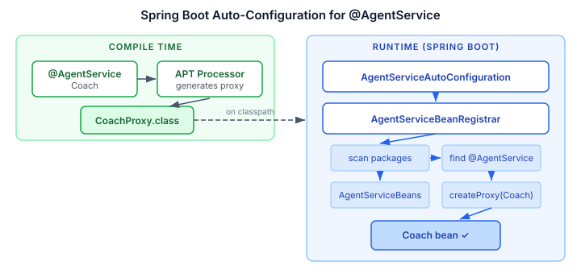

# Spring Discovers Your Agents

The Quarkus CDI wiring for `@AgentService` has worked well since it landed, but it demands a `@Produces` method for every interface. That's fine in CDI where producers are idiomatic — but Spring developers expect their beans to appear by convention, not by ceremony. `agent-service-spring` closes that gap.

## The problem with ceremony

In CDI, wiring a proxy looks like this:

```java
@Produces
Coach coach(AgentServiceBeans beans) {
    return beans.createProxy(Coach.class);
}
```

One method per interface. It compiles, it works, it's exactly the kind of boilerplate Spring Boot auto-configuration was designed to eliminate. A Spring developer adding the agent starter shouldn't need to know that APT-generated proxies exist, or that `AgentServiceBeans` is the factory that constructs them.

## How the auto-discovery works

The module has two classes. `AgentServiceAutoConfiguration` registers `AgentServiceBeans` as a Spring bean and declares a static `AgentServiceBeanRegistrar`. The registrar is a `BeanDefinitionRegistryPostProcessor` — it runs during context startup, before any regular beans are created.



The registrar does three things:

1. Retrieves the application's base packages from `AutoConfigurationPackages` — the same mechanism JPA auto-config uses to know where to scan for entities.
2. Runs a `ClassPathScanningCandidateComponentProvider` with an `AnnotationTypeFilter` for `@AgentService`, overriding `isCandidateComponent` to accept interfaces (the default rejects them).
3. For each discovered interface, registers a `GenericBeanDefinition` whose supplier lazily resolves `AgentServiceBeans` from the `BeanFactory` and calls `createProxy()`.

The lazy resolution matters. Post-processors run before regular beans exist. The supplier captures the `BeanFactory` reference but doesn't call `getBean(AgentServiceBeans.class)` until the proxy bean is actually instantiated — by which point `AgentProvider` and `AgentResolver` have been created by the agent backend auto-configurations.

## The constructor gap

`AgentServiceBeans` was written for CDI, which uses field injection via `@Inject`. Spring's `@Bean` factory methods need constructor-based wiring. Adding a two-argument constructor alongside the implicit no-arg one was the smallest change that enables both frameworks — CDI continues using field injection as before, Spring passes the dependencies explicitly.

## What the consumer sees

```java
@AgentService(model = "fast", descriptor = "coach")
public interface Coach {
    @Query("Break ${goal} into tasks")
    String decompose(@Param("goal") String goal);
}
```

That's it. The APT processor generates `CoachProxy` at compile time. The auto-configuration discovers `Coach` at runtime and wires the proxy as a singleton bean. `@Autowired Coach coach` works without any additional configuration — just the starter on the classpath.

This is the first module in the platform to use `AutoConfigurationPackages` for classpath scanning. The pattern is worth noting because it'll apply anywhere we need to discover annotated interfaces that have compile-time-generated implementations — a pattern that's becoming more common as the platform grows.
