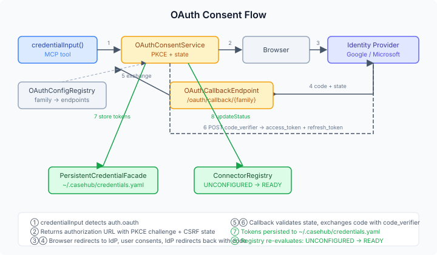

# One Consent to Rule Them All

The connector lifecycle now has manifests and dependency chains. But five Google modules and three Microsoft modules still sit outside it — each with its own `*Beans.java` CDI producer, each wiring `ServiceConnectionProvider` by hand. They share a client ID and client secret, yet nothing in the system knows they're related.

The family model fixes this. A family manifest declares what a group of connectors share: OAuth endpoints, scopes, client credentials, and consent strategy. Each member manifest references the family by name and inherits everything. After resolution, the manifest is self-contained — no downstream code needs to know families exist.

## The Design Tension

The interesting constraint here isn't the YAML. It's the wiring gap between the Phase 1 synthetic bean pipeline and what OAuth connectors actually need.

Phase 1 connectors take credential strings as constructor parameters — `NumbrrsMobilePlatform(String apiKey, String numbers)`. The build extension resolves `field: api-key` via `ProviderCredentialFacade` and passes the value. Clean, uniform, works.

OAuth connectors don't take credential strings. They take `ServiceConnectionProvider` — a CDI singleton that handles token retrieval, refresh, and scope management. The provider name ("google", "microsoft") is a call-time parameter, not a bean discriminator. Every Google connector, every Microsoft connector, and GitHub all inject the same singleton instance.

I expected this to need a new constructor-arg type — `service-connection: google` to tell the pipeline "inject ServiceConnectionProvider scoped to this provider." Claude's decision review caught it immediately: `ServiceConnectionProvider` is already a CDI bean. The existing `bean:` arg type handles it. No new mechanism needed.

That single insight collapsed three days of planned work into nothing. The manifest for a Google connector looks like this:

```yaml
connector:
  id: calendar-google
  platform: calendar
  auth:
    type: oauth2
    family: google
  produces:
    - class: ...GoogleCalendarPlatform
      type: platform
      constructor-args:
        - bean: ...ServiceConnectionProvider
```

No new syntax. No special handling. The existing pipeline already knows how to inject beans.

## Family Resolution


The resolution happens inside `ConnectorManifestLoader.discoverFromClasspath()`. After scanning `META-INF/connector-manifest.yaml` files, it calls `FamilyManifestLoader.discover()` to find `META-INF/families/*.yaml`, then runs `enrichWithFamily()` on every manifest whose `auth.family` is set. The enrichment replaces the member's empty `auth.fields` with the family's field definitions and populates `auth.oauth` with the family's OAuth config.

After this, every consumer sees the same resolved data. The build extension, the registry, the MCP tools — none of them know about families. They just see a manifest with fields, OAuth config, and a `credentialKey()` that returns "google" instead of "calendar-google". Shared credentials, one consent flow, zero family-specific branching downstream.

## Two Consent Strategies

Google supports incremental consent natively — request Calendar scopes now, Drive scopes later, no re-prompt for what's already granted. Microsoft doesn't — all scopes must be declared upfront. Making this a universal policy would have been wrong for at least one provider.

The family manifest declares its own strategy: `consent: incremental` for Google, `consent: aggregated` for Microsoft. The consent flow reads it and behaves accordingly. The field is there for the future — Phase 3 always requests all declared scopes, because true per-module activation needs a trigger that doesn't exist yet. But the data model is ready.

## The Consent Flow

With family resolution in place, the next question is: how does a user actually authorize?

The existing `CredentialFormService` renders an HTML form in the browser — the user types their API key, the form POSTs it, the credential store saves it. Clean for API keys, but OAuth doesn't work that way. OAuth is a redirect dance: build an authorization URL, send the user to Google or Microsoft, receive a callback with an authorization code, exchange that code for tokens. The credential never passes through the user's hands at all.



`OAuthConsentService` drives the entire flow from the family manifest's `OAuthDeclaration`. It generates a PKCE `code_verifier` (32 random bytes, base64url), computes the SHA-256 `code_challenge`, creates a CSRF `state` parameter with a 10-minute TTL, and builds the authorization URL with all of it. The URL templates in the manifest — `{callback-base-url}` and `{tenant-id}` — get resolved at build time from config and the credential facade respectively.

The callback endpoint at `/oauth/callback/{family}` receives the redirect, validates the state parameter (single-use, TTL-checked), and exchanges the authorization code for tokens. The exchange POST includes the `code_verifier` — the IdP verifies it against the challenge from the original authorization request, completing PKCE. Tokens go to both `StaticCredentialStore` and `PersistentCredentialFacade`, then the registry re-evaluates every connector that shares the credential key.

The branching in `credentialInput()` is minimal. If the manifest has `auth.oauth` populated (which it does after family resolution), return the OAuth authorization URL. If not, fall through to the existing credential form. The MCP tool's caller — typically an LLM — just sees a URL to present to the user. It doesn't know or care whether that URL opens a form or starts an OAuth dance.

## Persistent Credentials

The `InMemoryCredentialFacade` was a read-only snapshot — created once at startup from whatever the build extension could find. Store a token at runtime and the facade didn't see it. The registry couldn't see it either, so `connectorStatus` queries lied about configuration state until the next restart.

`PersistentCredentialFacade` fixes this by reading and writing `~/.casehub/credentials.yaml`. On construction it loads the YAML into a `ConcurrentHashMap`. On `store()` it updates the map and persists the whole file. The registry checks the same facade for `isConfigured()`, so storing a token now immediately flips the connector from UNCONFIGURED to READY — no restart needed.

The same bridge applies to the credential form. `CredentialFormService.submitCredentials()` now stores to both `StaticCredentialStore` and the facade, then calls `ConnectorRegistry.updateStatusByCredentialKey()`. Whether credentials arrive via API key form or OAuth consent, the status update path is the same.

## What's Built

Six batches landed across two sessions. The first three: `FamilyManifest` record and loader, build extension changes (`value:` constructor-arg kind, `@Named` qualifier support, `OAuthConfigRegistry`), and `ConnectorRegistry.updateStatus()`. The next three: `OAuthConsentService` with PKCE and CSRF, `OAuthCallbackEndpoint`, `credentialInput()` OAuth branching, `PersistentCredentialFacade`, and dynamic registry status updates.

The Microsoft migration has one interesting wrinkle ahead. `DocumentMicrosoftBeans` produces two `MicrosoftDrivePlatform` instances — one for OneDrive (`/me/drive`), one for SharePoint (`/sites/{siteId}/drive`). The `qualifier` field on `BeanDeclaration` and the `value:` constructor-arg exist specifically for this case: same class, different configuration, disambiguated by `@Named`. The per-provider migrations (#375, #376, #377) are queued and ready — the infrastructure they need is now in place.
